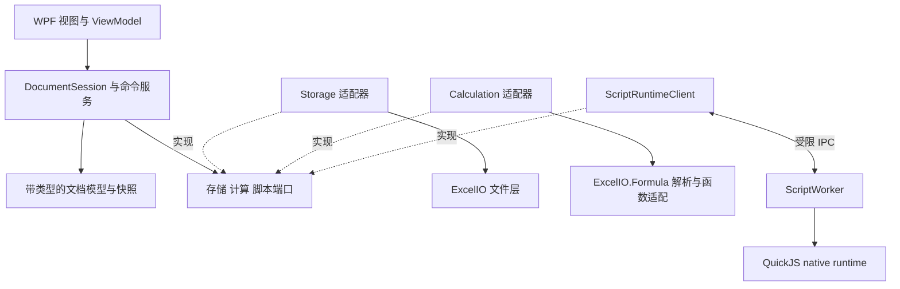
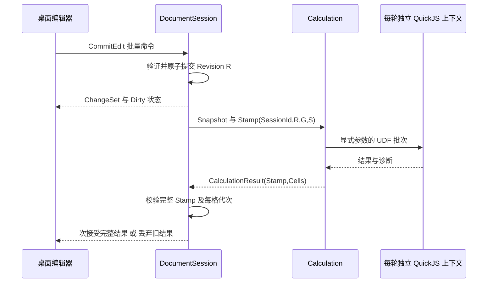

# QuickExcel 系统架构

> 2026-10-27 更新：M3 计算支持已落地。以下保留历史与长期目标，当前公式/结构/脚本参数桥/导出范围以 [M3 支持矩阵](10-m3-calculation.md) 和 ADR-018 为准。

当前为 **0.3 文件预览**：M1 文档会话与 M2 类型化文件路径已接入。WPF 组合根使用 TypedWorkbookStorage，核心依然不引用 ExcelIO；XLSQ v2 的 workbook.xlsx 是值/公式/缓存/样式的唯一权威。LegacyWorkbookStorage 保留为 v1 回归适配。下文注明 0.2 的段落为历史，M4 worker/动作及完整 Beta 仍未交付。实现范围见 [M2 记录](09-m2-files-and-types.md)。

## 当前实现与演进起点

| 当前代码 | 当前职责与限制 | 演进方式 |
| --- | --- | --- |
| [MainWindow.xaml.cs](../MainWindow.xaml.cs)、[EditorController.cs](../EditorController.cs)、[DocumentViewModel.cs](../DocumentViewModel.cs) | 控件提交、统一编辑/粘贴/撤销入口、会话状态投影；保留 DataGrid | M5 扩展视图拆分、网格和交互验收 |
| [WorkbookDocument.cs](../../QuickExcel.Core/WorkbookDocument.cs)、[DocumentSession.cs](../../QuickExcel.Core/DocumentSession.cs) | facade、不可变快照、串行写入门禁、事务历史、计算代次与保存修订 | M3 扩展计算协调，M4 接入动作事务 |
| [LegacyWorkbookStorage.cs](../../QuickExcel.Infrastructure/Storage/LegacyWorkbookStorage.cs)、[DocumentPackage.cs](../../QuickExcel.Infrastructure/DocumentPackage.cs) | Infrastructure 内的 XLSQ v1/XLSX 适配、容量预检、同目录原子保存 | M2 实现类型保真、v2 格式和损失报告 |
| [LegacyWorkbookCalculator.cs](../../QuickExcel.Infrastructure/Calculation/LegacyWorkbookCalculator.cs) | 消费稀疏快照，按类型求值和同表依赖完整重算 | M3 完成跨表、名称、增量和完整公式契约 |
| [QuickJsRuntimeFactory.cs](../../QuickExcel.Infrastructure/Scripting/QuickJsRuntimeFactory.cs)、[QuickJsSession.cs](../../QuickExcel.Scripting/QuickJsSession.cs) | 每轮授权计算新建并释放进程内 QuickJS 上下文 | M4 移入 ScriptWorker |
| [ExcelIO.Formula](../../../ExcelIO/ExcelIO.Formula/ExcelIO.Formula.csproj) | 解析器、内置函数和旧计算引擎 | 先复用解析与函数；typed evaluator、重算图逐步统一到 Calculation |
| [XlCell.cs](../../../ExcelIO/ExcelIO/XlCell.cs) | 字符串值、公式、静态变更回调 | 作为旧库兼容模型，停止承担新编辑器的唯一数据模型 |

当前只有 `DocumentSession.TryCommitCalculation` 发布公式缓存。适配器复用旧解析器和内置函数，不调用 `FormulaEngine.Calculate` 另行写入文档。ExcelIO 仍是独立源依赖，本次 M1 不修改其源码。

## 模块和依赖

0.2 已建立真实编译边界：`QuickExcel.Core` 仅引用 .NET，包含 `QuickExcel.Domain`、会话及存储/计算/脚本端口；`QuickExcel.Infrastructure` 引用 Core、ExcelIO、ExcelIO.Formula 和 QuickExcel.Scripting，承载 `QuickExcel.Storage`、`QuickExcel.Calculation`、`QuickExcel.Runtime` 具体适配器。Desktop 的 [应用组合根](../DesktopComposition.cs) 注入服务；Core 不构造旧库模型或 native 会话。

以下为后续目标模块，不表示这些项目已全部建立。按实际编译、独立发布或测试需求继续拆分，避免仅靠命名空间宣称隔离。

| 模块或目标项目 | 负责 | 允许依赖 |
| --- | --- | --- |
| QuickExcel.Domain | 类型、地址、稀疏存储、样式、快照、变更集 | .NET 基础库 |
| QuickExcel.Core | DocumentSession、命令队列、撤销、保存协调；定义存储/计算/脚本端口 | Domain |
| QuickExcel.Calculation | AST 适配、typed evaluator、函数目录、依赖图与调度 | Core 端口、Domain；过渡期 ExcelIO.Formula |
| QuickExcel.Storage | XLSQ、XLSX、格式迁移、恢复草稿、损失报告 | Core 端口、Domain、ExcelIO |
| QuickExcel.ScriptContracts | IPC 和脚本值 DTO、版本与错误代码 | .NET 基础库；不得引用 WPF、ExcelIO 或 native runtime |
| QuickExcel.Scripting | 桌面侧运行时客户端与 worker 管理；原生适配器作为内部组件 | Core 端口、Domain、ScriptContracts |
| QuickExcel.ScriptWorker | 可执行的 JS 宿主，native 资源与消息循环 | ScriptContracts、Scripting 的原生适配子模块 |
| QuickExcel.Desktop | WPF、ViewModel、网格、编辑器、文件对话框、启动组合 | Core、Domain；仅启动组合代码引用具体适配器 |

若 Scripting 拆出 `QuickExcel.Scripting.Native`，该子模块仅引用 ScriptContracts，不反向引用 Core；Worker 引用这个子模块，不引用桌面侧客户端。这样进程启动、协议和 native 引擎不存在循环引用。

下图描述 M4 的目标调用关系；0.2 的运行时适配器仍直接调用进程内 QuickJS，没有 IPC 或 ScriptWorker。



图中的运行时调用通过端口注入。Core 不直接构造 native runtime、文件对话框或 WPF 控件。第一阶段使用手动组合即可，依赖注入容器不是前置要求。

## 带类型的文档模型

**M1 已接入（2026-10-22）**：[Domain](../../QuickExcel.Core/Domain/WorkbookSnapshot.cs) 的不可变稀疏模型已经用于 facade、桌面、计算及文件边界。值/缓存契约见 [ADR-014](07-architecture-decisions.md#adr-014dom-001-的值缓存与日期边界)，本轮具体取舍见 [ADR-015](07-architecture-decisions.md#adr-01502-试用版的-m1-落地边界)。

`CellValue` 采用显式联合类型：`Blank`、`Number`、`Text`、`Boolean`、`Error`。`Number` 使用有限的 IEEE 754 double；NaN/Infinity 转为明确错误。文本 `00123` 和数字 `123` 不得因显示相似而合并，空白与空字符串也保持区别。

日期目标采用数值序列、数字格式和工作簿日期系统的组合。当前已提供显式 `ExcelSerialDate` 辅助转换，未完成数字格式文件保真或 JS 日期 API；不把所有看起来像日期的文本自动转换。1900/1904、闰日兼容和时区无关的领域转换已有契约，文件和日期函数仍由 M2/M3 验收。

当前实体边界：

```text
WorkbookSnapshot
  DocumentId, Revision, DateSystem, ScriptSource
  Sheets: ordered immutable WorksheetSnapshot array
  Styles: StyleId -> immutable StyleDefinition

WorksheetSnapshot
  SheetId, DisplayName, SparseCells, RowMetadata, ColumnMetadata
  Merges, Images, ViewMetadata

CellContent
  Literal: CellValue
  或 Formula: originalText
  StyleId

CellCalculation
  Value: CellValue?  // null 表示没有缓存
  State: Fresh | Dirty | Running | Stale | Blocked | Error
  InputRevision, CalculationGeneration, ScriptGeneration, Diagnostics
```

`CellContent` 与 `CellCalculation` 分开，写入缓存不会触发新的输入编辑或清除公式。UI 通过格式化器得到 `DisplayText`，公式栏通过输入序列化器得到 `EditText`。显示字符串不参与计算。

当前领域构造入口是 `CellValue.FromText/FromNumber/FromBoolean/FromError` 与 `CellContent.FromLiteral/FromFormula`。`CellCalculation.Value == null` 表示没有缓存，与 `CellValue.Blank` 不同；Fresh 要求存在非错误值，Error 要求存在错误值，其余状态可携带旧缓存。诊断集合在构造时复制，修订/代次非负。样式表已随快照保存并校验引用；名称、持久化 AST 和绑定身份尚未加入。

工作表在会话内使用稳定 `SheetId`；新增表及其撤销/重做保留身份。单元格地址为 `SheetId + RowIndex + ColumnIndex`，索引从零开始。v1 不保存 SheetId，重新打开生成新身份。改名、排序和插入/删除行列的 UI/命令及引用变换仍是后续工作；目标统一更新公式、合并范围、选区、图片和名称，不能用正则替换公式字符串。

当前稀疏存储使用 `ImmutableDictionary<CellPosition, CellSnapshot>`；编辑远端单元格不分配前方空行或空格。行列元数据、样式和图片复制为不可变数据，不保留 ExcelIO 对象。旧 XLSX 文件边界仍需有界稠密转换，预检占位行/格预算后才能分配；因此“可稀疏编辑”不等于“任意跨度都可保存”。

## 文档会话和唯一写入入口

每个打开实例创建一个 `DocumentSession`，拥有当前快照、计算/脚本代次、授权状态、撤销/重做历史和已保存修订。不同实例有独立 SessionId。0.2 的唯一写入入口是同一同步锁保护的提交门禁，并未建立专用工作线程或异步 FIFO 队列；`ExecuteAsync` 只是同步命令的 Task 门面。

所有已支持输入修改经 `Execute/ExecuteAsync(command, expectedRevision)`。命令先验证地址、重复项、类型、样式、容量及总体大小，准备完整候选快照；任何一项失败均不提交。成功后递增 Revision；内容/新增表事务形成一条历史记录，计算结果发布不改变输入 Revision。通知在写锁外按顺序发布并携带对应快照；观察者异常不回滚已提交事务。

| 命令族 | 0.2 已实现 | 撤销内容 |
| --- | --- | --- |
| 内容 | SetCells、ClearCells；粘贴归入一次 SetCells | 原类型、公式、缓存及样式引用 |
| 结构 | AddSheet | 工作表及稳定身份 |
| 源码 | UpdateScriptSource | 使用脚本编辑控件自身历史，不进入单元格历史 |

撤销/重做默认采用 **32 MiB 估算预算**，并非精确托管堆上限；累计超限释放最早记录并在界面显示计数。单次事务自身超预算时整批拒绝。历史保留不可变输入和缓存，撤销/重做产生新 Revision，并把公式缓存标记过期；不会重新执行历史脚本。源码修改保留单元格撤销/重做记录，但撤销执行授权并提升脚本及计算代次；单元格历史始终保留当前源码，不恢复旧授权。完整样式、行列结构、排序和脚本动作命令未交付。

## 编辑和重算的时序



计算和文件 I/O 使用捕获的不可变快照，在会话写锁外执行；结果回到相同写入门禁提交。0.2 桌面用后台任务执行耗时操作，期间禁用工作区和工具栏，尚未交付边计算边编辑的完整体验。Core 的代次回归已覆盖计算中编辑等交错；取消只是节省工作，即使取消失败也不能越过版本门禁。

`CalculationStamp` 必须同时匹配 **SessionId、InputRevision、CalculationGeneration、ScriptGeneration**，且会话未关闭。每格缓存也须匹配结果的三种修订/代次；非法格、非法值或任一格版本错误使整批失败。接受结果后消费该计算代次，重复提交也失效。编辑、撤销、再次重算、源码变化、启停、编译失败或关闭均不能让迟到结果覆盖新状态。启停授权不推进输入 Revision，也不使已保存源码变脏。

会话通知提供变更单元格与完整已提交快照。0.2 DataGrid 仍可能重建视图，按可见区域精准更新和大表性能验证留给 M5；诊断及运行时日志已有数量限制。

## 计算服务

0.2 的 `LegacyWorkbookCalculator` 消费稀疏快照，复用旧 FormulaParser 和标量内置函数；直接引用保持值类型，同表依赖按稳定拓扑顺序完整重算。跨表及禁用 UDF 的公式与其下游保留缓存并标记 Blocked；循环及依赖循环产生 Cycle 错误。每轮授权计算重建独立 JS 上下文，无跨轮闭包复用。整轮超时/取消抛出且不返回部分结果。

旧解析器、数字文本 coercion、日期函数的文本结果仍有限制。IF/IFERROR 求值会跳过未选分支，但依赖图仍保守收集全部分支，不能宣称完整 Excel 惰性依赖语义。

目标计算管线为：词法/语法解析 → 引用与名称绑定 → 类型化求值 → 依赖维护 → 调度 → 原子发布结果。持久 AST 缓存、名称绑定和增量调度仍待 M3。

M3 的主要规则：

- 图节点使用完整跨表地址；显式单格、范围和名称引用产生依赖。范围使用索引查询，不逐一展开整列空白单元格。
- 输入改变只使传递依赖闭包变脏；结构变化按受影响表/范围重建绑定。函数注册变化使引用该函数的公式及其下游失效。
- 使用强连通分量识别真正的环。环上的单元格与依赖于环的单元格产生可区分诊断，不能把所有未计算节点都误报成自身循环。
- 同一拓扑层可以批量求值；JS 调用按工作簿 worker 顺序执行。确定性规则稳定前不承诺并行 UDF 或跨次结果记忆化。
- IF、IFERROR 等控制类函数需要正确的短路规则；错误值作为类型传播，不能与文本 `"#VALUE!"` 混淆。
- `TODAY/NOW` 使用一次重算的固定时钟快照；volatile 函数显式标记。JS 侧时间/随机/可变全局状态见运行时契约。
- 支持参数数目校验、大小写规范化、命名空间与内置函数冲突检查。先修解析器再开放扩展名称，不能只有注册器支持。
- 不支持的函数或外部引用保留原公式并标记 Blocked/Stale。旧缓存不能冒充本版本刚计算出的值。

上述增量规则先应用于已支持的确定性公式。M3 在尚未验证 JS 纯度时，对含 JS 的工作簿采用保守路径：每轮重建已获授权的运行上下文，以稳定顺序完整重算，不复用输入未变的 UDF 或其下游结果。脚本未启用时仍保留旧值并标记阻塞，不借重算隐式取得授权。JS-010 的执行契约必须在 CALC-003 前确定，M4 再落实 worker 严格策略；更细的 JS 增量优化须经策略验证后开放。

增量算法发布前与全量参考计算在支持的确定性公式子集内做等价回归；不能把任意 JavaScript 的时间、随机或可变闭包结果纳入未经证明的等价承诺。原有 Formula 测试继续运行；需要改变旧库公开语义时，在旧库中单独记录和验证，不随桌面重构悄然修改。

## 保存和恢复

0.2 保存入口先提交活动网格/公式栏及源码编辑，并处理待重算输入，再由 facade 的保存锁串行捕获快照、调用存储适配器。适配器写同目录临时文件，刷新并替换成功后才调用 `MarkSaved`；失败保留旧文件和未保存状态。当前没有 v2 缓存状态持久化、导出规划器或完整的等待/冻结选择流程。

如果保存 Revision R 时会话已经编辑到 R+1，文件仍是完整的 R，`SavedRevision` 只推进到 R，不能把 R+1 当作已保存。重复保存串行化，旧保存完成通知不能倒退已保存修订。外部文件冲突检测、写后完整重开验证和恢复草稿仍是 M2/M6 目标。

自动恢复是独立的本地草稿流程，有自己的路径、版本、保留策略和隐私约束。恢复文件不等于用户正式保存，不沿用脚本启用状态。详情见 [文件格式](03-file-format-and-compatibility.md)。

## 桌面呈现

已提取 `EditorController` 和只读 `DocumentViewModel`，网格、公式栏、粘贴、清除和撤销均转到同一会话入口。后续继续拆分 Workspace/Sheet/ScriptEditor/Diagnostics ViewModel，并通过 `IGridSurface` 隔离网格；这些目标类型尚未全部存在。

M1 保留 DataGrid 以维持可试用路径；M5 用同一数据源验证其双向滚动、冻结、合并、IME 和可访问性。如果达不到性能预算，再在适配边界后实现专用网格。先做可测量的对照原型，不直接承诺重写整个渲染器。

WPF 的控件虚拟化与数据虚拟化不同：只虚拟化视觉容器，并不会自动减少绑定模型的数据量。因此可见区域数据提供器和稀疏领域存储必须单独设计。[WPF 控件性能文档](https://learn.microsoft.com/en-us/dotnet/desktop/wpf/advanced/optimizing-performance-controls)

中文输入法组合期间不提交中间内容；提交、失焦、Escape、Enter/Tab 与保存采用统一编辑会话。单元格格式化与编辑格式分离。剪贴板同时提供有类型的应用内格式与 TSV 文本，并定义引号、换行、公式和区域形状的规则。

## 生命周期和诊断

0.2 关闭会话后拒绝新写入和迟到计算，并释放历史与通知订阅；每轮运行时由计算适配器释放。目标 worker 关闭流程还需处理 Closing、取消、中断与进程终止，不能把当前进程内资源释放视为崩溃隔离。

错误分类包括输入校验、公式错误、脚本异常、超时、worker 崩溃、文件损坏、版本不支持和保存失败。诊断包含会话、操作、单元格/模块位置及可展示信息；默认日志不记录单元格内容、完整源码或个人路径。

技术决策与替代方案见 [架构决策](07-architecture-decisions.md)，实现顺序见 [实施计划](05-implementation-plan.md)。
