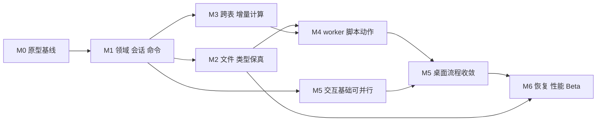

# QuickExcel 实施计划

## 当前进度（2026-11-02）

新增 [61 号 Avalonia 迁移方案](61-avalonia-migration-plan.md)：使用 MIT 开源 Avalonia，A0–A7 覆盖技术验证、共享层/主网格迁移、PDF.js/Monaco、新宿主发布和非 Windows 平台支持。当前仅完成方案编写，各实施阶段均未开始；现有 WPF 交付、XLSX 对齐成果及 M4/M5/M6/E5 未关闭项保持各自状态。

59 号 Skia 迁移 P0–P4 声明范围完成：共享 net10.0 渲染、直接 PDF、按需预览、主网格和旧绘制依赖清理已接入；Windows/Linux 无界面输出、定向功能检查及原有 16.67 ms 横向/33.34 ms 拖选预算通过。最终候选包、固定版本、许可证、测量修正与失败样本见 [60 号实施记录](60-skia-rendering-and-pdf-implementation.md)。物理设备、完整应用跨平台及既有 M4/M6 门禁保持独立。

E4 XC-0401–0405 已完成声明范围：打印/PDF、三类图片锚点、基础图表、工作表保护/传统批注、容量分级均实现并有 Excel、WPF、PDF/DPI 与原始基准证据，详见 [57](57-e4-reporting-and-capacity.md)。289 项相关回归和最后 117 项专项通过，Excel 81 项、WPF 23 项通过。当前为工作区实现，未生成新发布包；E5、M4/M6 保持未完成。

E2 的 XC-0201 已完成工作簿内复制/剪切及选择性粘贴，11 条 Excel 对照路径、59 项相关回归与 120 项 WPF 通过，限制见 [40](40-internal-clipboard.md)。XC-0202 填充与序列也已完成，17 条真实 Excel 往返、71 项相关测试及最新 23 项填充专项通过，见 [41](41-fill-and-series.md)。XC-0203 录入和公式编辑已完成，52 项相关规则、37 项专项及 92 项既有 WPF、真实 Excel 导航/引用/重开通过，见 [42](42-formula-entry-and-navigation.md)。XC-0204 工作表复制/重排与名称管理完成，90 项相关测试、15/151 项 WPF 和七条真实 Excel 对照通过，见 [43](43-sheet-and-name-management.md)。XC-0205 条件统计完成，1,706 条真实 Excel 公式、126 项相关回归及 49 项 WPF 通过，见 [44](44-conditional-functions.md)。XC-0206 查找公式完成，604 条真实 Excel 公式、193 项相关回归及 59 项 WPF 通过，见 [45](45-lookup-functions.md)。XC-0207 日期/数学及工作日完成，3,024 条真实 Excel 公式、134 项相关及 81 项 WPF 通过，见 [46](46-date-and-math-functions.md)。XC-0208 文本/类型公式完成，4,658 条真实 Excel 公式、37,264 项往返、最终 34 项专项及 99 项 WPF 通过，见 [47](47-text-and-type-functions.md)。XC-0209 计算与导出边界完成，1352 条真实 Excel、270 个参数边界、134 项专项和 110 项 WPF 通过，见 [48](48-calculation-and-portable-export.md)。XC-0210 状态栏与格式效率完成，104 条真实 Excel 小数位命令、三种统计状态、95 项专项及 18 项 WPF 通过，见 [49](49-selection-statistics-and-format-efficiency.md)。E3 XC-0301 筛选/排序持久化完成，37 个 Excel 案例、333 项往返和 85/153/18 项 WPF 通过，见 [50](50-filter-and-sort-persistence.md)；XC-0302 Table 基础完成，60 种内置样式、60,336 项往返及真实 Excel/WPF 通过，见 [51](51-excel-table-basics.md)；XC-0303 结构化引用与表编辑完成，20,891 项往返、170 项相关测试及 Excel/WPF 通过，见 [52](52-structured-references-and-table-editing.md)；XC-0304 数据验证完成，1,370 个真实 Excel 案例、45,210 项往返、180 项相关及 18/153/92 项 WPF 通过，见 [53](53-data-validation.md)；XC-0305 条件格式基础完成，131,982 项模型/往返、29,489 项 Excel 输出复验、205 项相关及 17/153 项 WPF 通过，见 [54](54-conditional-formatting.md)；XC-0306 常用清洗命令完成，两种日期系统 54,786 项往返、18,432 项 Excel 输出复验、196 项相关及 19/153 项 WPF 通过，见 [55](55-data-cleaning.md)；XC-0307 分组与分类汇总完成，131,545 项往返、37,928 项 Excel 输出复验、202 项相关及 16/153 项 WPF 通过，组合边界见 [56](56-outline-and-subtotals.md)。E3 声明范围完成，本轮按用户要求止于 E3。

本节是当前里程碑与待办的统一入口；各专题保留实现契约和原始证据，标注日期的历史记录不代表当前待办。项目版本仍为 `0.6.0-preview.3`，当前处于 M5 桌面交互收敛阶段。**按用户 2026-10-30 的明确要求，当前重点工程调整为 XLSX 兼容性与 Excel 常用功能对齐**；独立分阶段清单见 [26 号计划](26-excel-compatibility-roadmap.md)。M4 未关闭项和 M6 门禁保留，但不作为扩大本轮实现范围的理由。

| 阶段 / 工作 | 当前状态 | 已交付范围与剩余事项 |
| --- | --- | --- |
| XLSX / Excel 对齐重点工程 | E0–E4 声明范围完成；E5 未开始 | 已有矩阵、10 个合成夹具、独立校验和分级诊断；修复行格式应用标志与空白格继承/清除。最新 260 项既有相关测试、5 项新测试、34 项工具测试及 26/92 项 WPF 专项通过。XC-0101 已有 43 个 Excel 16.0 build 20527 固定结果及重开对照、114 项 Core 和 31 项 WPF 通过，见 [30](30-excel-number-formats.md)；XC-0102 的 104 属性 Excel 对照、34 项工具与 36 项 WPF 通过，见 [31](31-xlsx-named-styles-and-theme.md)。XC-0103 接入 XLSX 保留公式保存、文档属性白名单和冲突保护，125 项相关回归、最终 18 项保存专项、34 项工具与 50 项 WPF 通过，真实 Excel 属性/公式重开通过，见 [32](32-xlsx-save-and-metadata.md)。XC-0104 冻结/缩放/活动格与可见性持久化完成，真实 Excel 视图和插行对照、74 项视图/151 项工作区/41 项产品 WPF 通过，见 [33](33-xlsx-workbook-views.md)。XC-0105 页面/打印元数据 R/W 完成，140 项相关回归、最终 8 项页面专项、36 项工具和真实 Excel 三表 144 项对照通过，含分页的删除/移动仍拒绝，见 [34](34-xlsx-page-and-print-metadata.md)。XC-0106 受控公式保留完成，159 项相关专项、36 项工具、84 项 WPF 和真实 Excel 只读/未知函数对照通过，见 [35](35-xlsx-preserved-formulas.md)。XC-0107 富文本/链接/批注完成，173 项相关回归、最终 16 项内容/格式专项、97 项 WPF 和真实 Excel 逐字符/附件对照通过，见 [36](36-xlsx-rich-text-links-and-notes.md)。XC-0001 已补齐五类六份真实 Excel 样本，5384 属性通过，见 [37](37-excel-business-baseline.md)。XC-0002 的 48 路径独立 Excel 编辑对照完成，见 [38](38-excel-edit-matrix.md)。XC-0003 定位收尾完成，112 项相关、103 项 WPF 通过，见 [39](39-xlsx-diagnostic-closure.md)。XC-0201 内部剪贴板及 XC-0202 填充/序列完成，见 [40](40-internal-clipboard.md)/[41](41-fill-and-series.md)。XC-0203 录入/公式辅助完成，见 [42](42-formula-entry-and-navigation.md)。XC-0204 工作表与名称管理完成，见 [43](43-sheet-and-name-management.md)。XC-0205 条件统计完成，见 [44](44-conditional-functions.md)。XC-0206 查找公式完成，见 [45](45-lookup-functions.md)。XC-0207 日期/数学及工作日完成，见 [46](46-date-and-math-functions.md)。XC-0208 文本/类型公式与文本兼容版本完成，见 [47](47-text-and-type-functions.md)。XC-0209 计算/可移植导出完成，见 [48](48-calculation-and-portable-export.md)。XC-0210 状态栏/格式效率完成，见 [49](49-selection-statistics-and-format-efficiency.md)。E2 声明范围完成；E3 XC-0301 已完成，见 [50](50-filter-and-sort-persistence.md)，Table 基础已完成，见 [51](51-excel-table-basics.md)；XC-0303–0307 也已逐项完成，最新边界与验收见 [56](56-outline-and-subtotals.md)。此前证据见 [27](27-xlsx-compatibility-baseline.md)/[28](28-xlsx-compatibility-diagnostics.md)/[29](29-xlsx-row-style-inheritance.md)，清单见 [26](26-excel-compatibility-roadmap.md) |
| M1 领域 / 会话 / 命令 | 完成 | 类型化稀疏模型、修订与代次门禁、统一事务及撤销；历史证据见 [08](08-baseline-and-progress.md) |
| M2 文件 / 类型 | 受支持子集完成 | XLSQ v2、v1 迁移、类型保真、兼容报告与保存保护；支持范围见 [09](09-m2-files-and-types.md)，后续 XLSX 显示与颜色修正见 [25](25-xlsx-rendering.md) |
| M3 计算 | 受支持子集完成 | 跨表、结构引用、标准公式增量计算、缓存状态和两种导出；JS 继续保守完整重算，见 [10](10-m3-calculation.md) |
| M4 worker / 脚本 | 进行中 | worker、模块、actions、UDF 合批、无能力 AppContainer 和崩溃资源回收已接入；严格策略及完整部署矩阵未完成，见 [14](14-m4-batching.md)–[16](16-m4-recovery-and-deployment.md) |
| M5 桌面交互 | 进行中 | 正式工作区、脚本页、签名信任、Ribbon、查找替换、筛选排序、图片/合并及 FastGrid 主网格已接入；真实 IME、跨屏 DPI、完整辅助功能等仍待验收 |
| 主网格迁移及近期修复 | 当前实现范围完成 | 旧 DataGrid / 试验窗口已移除；筛选滚动范围、尺寸拖动/双击自动尺寸、合并选区与 XLSX 显示已修复并有专项证据；见 [24](24-main-grid-migration.md)、[25](25-xlsx-rendering.md) |
| 横向拖动导致整桌面停顿 | 完成 | 2026-10-30 用户补充确认已解决，按该确认关闭缺陷；不将历史诊断推测写成已证明根因，也不把本次文档更新记作新增测试 |
| M6 恢复 / 性能 / Beta | 未完成 | 自动恢复后端、完整保存故障矩阵、性能基线、CI、原生可复现构建、最终 OS 安全及干净机器发布验收仍待完成 |

当前默认渲染为 `RenderMode.Default`；`--software-rendering` 仅作诊断选项。横向停顿已从待办移除，M5/M6 的其他验收范围不随该缺陷关闭而扩大。关闭记录及既有验证见 [主网格迁移](24-main-grid-migration.md)。

源码与发布包分别跟踪：Release 构建输出在 `artifacts/build/bin/QuickExcel.Desktop/release/`，已有 `artifacts/QuickExcel` 不会随源码构建自动更新；当前 `Start-QuickExcel.cmd` 从源码运行，未指定配置时为 Debug。发布目录身份与验收以其 `BUILD-METADATA.json` 为准。近期新增 E0 开发工具、字体写回修复、分级兼容报告及行列样式继承修复，未生成新包。后续工作顺序见第 10 节。

## 阶段更新记录（历史）

2026-10-29：[FastWpfGrid 方案](22-fastwpfgrid-and-data-operations.md) 已按用户要求切换主工作区并移除旧 DataGrid/试验窗口，尺寸事务、字体格式、图片/合并、编辑与保存有专项验收。实现和证据见 [主网格迁移](24-main-grid-migration.md)，试验阶段对照见 [历史记录](23-fast-grid-implementation.md)。

2026-10-28 正式界面更新：`0.6.0-preview.3` 接入启动页、可停靠工作表导航和脚本专页，并推进 JS-011/FMT-009/UI-006–008。查找替换、基础图片/合并及安全结构变换已有领域与 WPF 证据；恢复仅为手动副本打开原型，自动恢复与完整无障碍/跨环境验收仍未关闭。详见 [正式界面记录](19-m5-product-workspace.md)。

2026-10-28 M5 更新：UI-002 网格适配、虚拟化探索与 ADR-022，以及 UI-003 键盘/选区/剪贴板/编辑状态机本切片完成；32 项 WPF 交互断言和本机系统中文拼音实机验收通过，证据见 [M5 记录](17-m5-grid-and-input.md)。M4 保持下述未关闭项，不能据此宣布 M5 整体通过。

本计划从 M0 原型走向 Windows x64 Beta。M1–M3 支持子集已交付；M4 已接入独立 worker、可终止执行、包内 ES 模块、actions 快照事务、有界 UDF 合批及实际 worker 的无能力 AppContainer。2026-10-28 已取得 IPv4/IPv6 回环与 DNS 的本机 WFP 拒绝证据，并补齐宿主崩溃后的 profile/payload 回收及故障测试。M4 保持进行中，严格执行策略及完整部署矩阵未完成；M6 仍需干净机器与最终 OS 门禁。当前实现与验收见 [回收与部署验证](16-m4-recovery-and-deployment.md)、[合批记录](14-m4-batching.md)、[隔离 ADR](15-m4-os-isolation-adr.md)及 [actions 记录](13-m4-actions.md)。以下 M3 记录保留为历史基线。

### M1–M3 历史实施状态（2026-10-27）

M2 已提交为 813e91d。M3 支持矩阵内实现和发布验收完成：Release 0 警告/0 错误、331 项测试、native/WPF 及 ZIP 解压复验通过，详见 [M3 记录](10-m3-calculation.md)。下面的 M1 任务行保留历史证据。

| ID | 状态 | 范围与证据 |
| --- | --- | --- |
| BASE-001/002/003 | 完成 | 初始源码、环境、21 例原型回归、102 例首切片结果和历史发布失败均保留，见[实施记录](08-baseline-and-progress.md) |
| DOM-001 | 完成 | 类型值、内容/缓存分离、错误与有限数值、显式日期契约；不等于 v1 文件类型保真 |
| DOM-002 | 完成 | 稀疏快照、会话内稳定 SheetId、元数据深复制、远端编辑及随机参考模型回归；旧 IO 转换有独立密集分配预算 |
| APP-001、CMD-001/002 | 完成 | DocumentSession 串行写入、统一 Revision、事务预检、单条历史、内容与新增表撤销、32 MiB 历史预算及通知一致性 |
| APP-002 | 完成 | 快照计算和会话/修订/代次门禁；倒序返回、关闭/重开、源码与授权变化、取消后返回均拒绝旧结果 |
| APP-003 | 完成 | Core 为纯 .NET 无外部项目引用；Infrastructure 实现 ExcelIO/QuickJS 适配，桌面组合根注入端口 |
| UI-001 | 完成 | EditorController 与最小 ViewModel 已接入，编辑/撤销/保存统一提交；扩展 WPF smoke、发布版及 ZIP 解压后复验通过 |
| 0.2 试用版交付 | 完成 | Release solution 构建 0 警告/0 错误，Core 221 例通过；native/WPF smoke 通过，ZIP 和 SHA-256 已生成并核对，见实施记录第 6 节 |

0.2 的历史证据留在 `artifacts/validation/release-0.2`。M2 当时基于 `82381fe` 开发，后提交为 `813e91d`。FMT-003/004/005/006、IO-001、JS-004 的受支持子集实现、桌面接入和格式回归已完成，范围与发布验证单独记在 [M2 记录](09-m2-files-and-types.md)。

## 1. 里程碑与关键路径

关键路径是：类型/修订契约 → 格式与计算适配 → worker 及动作提交 → 桌面流程联调 → 恢复与发布。M2、M3 可在 M1 契约稳定后并行；M5 的 ViewModel 和交互基础可以提前进行，但不能在格式、计算和脚本能力未完成时宣布 M5 通过。测试、性能测量和 CI 随每阶段推进，M6 负责收敛证据，不承担所有测试的首次建设。

| 阶段 | 可交付给试用者的结果 | 进入条件 | 退出条件 |
| --- | --- | --- | --- |
| M0 当前原型 | 编辑、同表公式、QuickJS UDF、XLSQ v1 和 XLSX 快照导出 | 已有实现 | 记录现有证据和限制；不宣称完整 Excel 兼容 |
| M1 领域/会话/命令 | 原型行为保持，编辑与撤销通过统一入口，旧计算不覆盖新输入 | 固定 M0 示例与回归证据 | 类型/身份/修订契约冻结；事务、历史、会话测试通过 |
| M2 文件/类型 | 支持矩阵内 XLSX 类型保真、XLSQ v2、明确的迁移和损失报告 | M1 一致快照与类型模型 | v1/v2 往返、类型日期、预算、关系与原子保存测试通过 |
| M3 计算 | 跨表公式、结构引用更新、增量重算与缓存有效性 | M1；文件夹具与 M2 协作 | 增量结果等价于全量参考；错误/循环/取消/导出闭包正确 |
| M4 worker/脚本/动作 | 可终止的独立脚本执行，批量 UDF、模块和单步撤销的操作脚本 | M1 命令；M2 脚本包；M3 typed bridge | 崩溃不损坏文档；过期结果不提交；动作全有或全无；完成 OS 隔离策略原型 |
| M5 桌面体验 | 连贯的键盘编辑、多选、排序筛选、样式与脚本工作流 | M1；核心流程逐项依赖 M2–M4 | 主要试用路径、IME、无障碍、错误定位与兼容提示通过 |
| M6 Beta | 自动恢复、可复现构建、明确兼容范围和可安装发布包 | M1–M5 退出；恢复功能依赖 M2 保存协议 | 质量门禁、OS 隔离结论、性能实测、干净环境验收与发布说明齐备 |

各阶段先提供内部候选，再依据退出条件决定是否提供试用包。预算目标见 [质量与交付](06-quality-performance-and-delivery.md)，数值调整必须记录基准与原因，不能为了“通过”删除失败场景。

## 2. 任务编号与责任边界

本文件维护实施顺序和跨模块交付。`FMT-*` 的格式契约以 [文件专题](03-file-format-and-compatibility.md) 为准；`JS-*` 的脚本契约以 [运行时专题](04-scripting-and-runtime.md) 为准；`QA-*` 的判定与证据以 [质量专题](06-quality-performance-and-delivery.md) 为准。下面的责任方是模块角色，不代表已经分配给某位成员。

任务状态统一为待开始、进行中、待验收、完成或延期。只有实现、验收证据、文档三者一致才标记完成。大型任务可拆子任务，但不能因一部分合入而关闭父任务。依赖只使用任务或里程碑 ID，不依赖模糊的“先做完后端”。

## 3. M0：固定原型基线

M0 已有可试用程序，但仍需在后续开发起点固定可追溯证据。不得把本轮文档中的未来验收要求视作 M0 已通过。

| ID | 工作 | 输出与验收 |
| --- | --- | --- |
| BASE-001 | 固定源码与构建环境信息 | 保存 SDK、引擎 pin、native 构建参数、发布模式及示例文件哈希；能找到对应源码状态 |
| BASE-002 | 归档关键行为夹具 | 演示计算、脚本启停、稀疏 XLSX、XLSQ v1、导出快照；记录已知类型与跨表限制 |
| BASE-003 | 建立当前与目标能力表 | 将现有 21 个 Core 用例、native smoke、WPF smoke 的证据与未来验收分开；失败不可静默排除 |

格式和运行时现状分别关联 FMT-001、JS-001。已有记录可复用；只有源码或环境变化时才补跑相关基线，不反复执行无关全量验证。

## 4. M1：领域、会话与命令

责任方：领域/应用层主导，UI、存储和脚本适配配合。0.2 已将 `WorkbookDocument` 改为纯会话 facade；桌面通过 `DesktopComposition`、`EditorController`、`DocumentViewModel` 接入。Core 不引用 Infrastructure，旧包/ExcelIO/QuickJS 适配由 Infrastructure 实现。

| ID | 任务 | 前置 | 输出与验收 |
| --- | --- | --- | --- |
| DOM-001 | 带类型的值、内容与计算结果 | BASE-002 | Blank/Text/Number/Boolean/Error 区分；公式与缓存分离；数值有限性和日期系统明确 |
| DOM-002 | 稀疏存储、稳定 SheetId 与快照 | DOM-001 | 远端编辑不分配所有空格；快照不会被后续编辑改变；身份在改名/重排中保持 |
| APP-001 | DocumentSession 与单写入队列 | DOM-002 | 每次打开独立 session；统一 Revision 与关闭生命周期；所有写入可追踪 |
| CMD-001 | Set/Paste/Clear 的预检与事务 | APP-001 | 一个非法地址使整批失败；粘贴形成一条历史；通知与模型内容一致 |
| CMD-002 | Undo/Redo 与历史预算 | CMD-001 | 恢复类型、公式、缓存状态；Revision 单调递增；截断策略可见 |
| APP-002 | 计算快照和代次提交门禁 | APP-001 | 假调度器倒序返回、关闭重开、源码变化时旧结果均被丢弃 |
| APP-003 | 存储/计算/脚本端口与组合根 | APP-001 | Core 不构造 WPF/native 对象；旧实现由适配器接入；进程内取消限制如实暴露 |
| UI-001 | 编辑提交控制器与最小 ViewModel | CMD-002、APP-003 | 单元格/公式栏/粘贴/保存均走同一编辑提交流程；待提交编辑不会丢失 |

关联 FMT-002、JS-002/003、QA-DOM-01、QA-CMD-01、QA-SES-01。0.2 桌面已移除可变 XlWorkbook/XlCell 写路径和窗口自有撤销栈，并完成当时的 native/WPF 与归档验收。该版本使用 XLSQ v1、同表计算和进程内 JS；这些是历史边界，当前分别由 M2 的 v2、M3 计算及 M4 worker 替代。

## 5. M2：文件与类型保真

责任方：存储适配主导。读取时先获得独立领域快照，完整校验后再交给会话；失败不得破坏当前打开的文档。

| ID | 任务组 | 前置 | 输出与验收 |
| --- | --- | --- | --- |
| FMT-003 | XLSQ v2、版本校验与 v1 迁移 | M1 | 唯一 XLSX 内容来源、稳定表身份、状态元数据；迁移不执行脚本、不覆盖原文件 |
| FMT-004 | XLSX 类型、日期与样式适配 | DOM-001/002 | 文本 `00123`、布尔、错误、空白/空文本、1900/1904 逐项往返；历史丢失类型不猜测恢复 |
| FMT-005 | ZIP/XML/JSON 预算与关系解析 | FMT-003 | 限额在分配/解压前后执行；路径、重复条目、外部关系和取消都有确定结果 |
| FMT-006 | 已知/未知部件目录与损失报告 | FMT-004/005 | 可保留条目字节不变；编辑使未知依赖失效时提前报告，不以复制 ZIP 冒充无损 |
| IO-001 | 保存协调器接入新快照 | APP-003、FMT-003 | 只标记成功保存的 captured Revision；保存期间新编辑仍为 dirty；失败保留上次成功文件 |
| JS-004 | 脚本元数据持久化 | FMT-003 | 保存源码/API/模块声明；打开、迁移、恢复均不带入运行授权 |

M1 已实现 captured Revision 保存、失败不推进 saved Revision 和串行保存的基础门禁；M2 的 IO-001 与受支持格式子集已完成验收，见 [M2 记录](09-m2-files-and-types.md)。完整并发保存、恢复和故障矩阵继续由 M6/FMT-010 验收。M2 负责模块清单持久化，M4 已接入 FMT-008 模块执行；读取能力与执行能力分别报告。

## 6. M3：跨表与增量计算

责任方：计算模块主导，领域与存储配合。复用已验证的语法和函数实现，替换字符串强制转换及全局事件驱动的调度路径。

| ID | 任务 | 前置 | 输出与验收 |
| --- | --- | --- | --- |
| CALC-001 | AST 适配、名称绑定与 typed evaluator | DOM-001/002 | 单元格/区域/名称/工作表引用统一；显式转换、懒求值和错误传播符合支持矩阵 |
| CALC-002 | 工作簿依赖索引与完整重算 | CALC-001 | 跨表链正确；强连通分量定位循环；依赖循环的下游错误可区分；取消不发布半批结果 |
| CALC-003 | 增量失效和计算计划 | CALC-002、APP-002、JS-010 的 M3 契约 | 确定性标准公式只计算受影响闭包，随机编辑序列等价于全量参考；含 JS 工作簿先重建上下文并按稳定顺序完整重算，不复用 UDF/下游结果 |
| CALC-004 | 结构引用变换 | CALC-001、CMD-002 | 插入/删除/移动/表改名更新相对、绝对、混合及跨表引用；撤销可还原语义 |
| CALC-005 | 结果状态与诊断聚合 | CALC-002、APP-002 | 错误值、新鲜度、阻塞和旧缓存分别表达；错误可定位；禁用脚本不把缓存当新结果 |
| JS-005/006 | 类型桥接与函数描述符 | CALC-001 | v1 一维区域不变；v2 二维区域显式选择；命名空间解析、注册冲突和错误类型有契约测试 |
| JS-010（契约部分） | 先冻结 UDF 调度与纯度边界 | CALC-001、JS-005 | 在 CALC-003 前明确保守完整重算与上下文重建；全量/增量等价承诺限定确定性子集，不声称任意 JS 天然纯净 |
| FMT-007 | 缓存落盘和可移植公式导出 | CALC-002/003、M2 | JS 种子及跨表传递依赖冻结为值；独立受支持公式可保留；旧结果必须明确处理 |

验收以 QA-CALC-01 和乱序返回测试为主，不能只用截图观察几个结果。现有 ExcelIO.Formula 的回归先分类；不支持的 Excel 行为明确标记，不能为了通过旧用例继续污染新类型模型。结构编辑 UI 可在 M5 接入，但引用变换必须先有独立领域验证。

## 7. M4：worker、脚本模块与操作

责任方：脚本运行时主导，计算/应用层配合。开发测试可以使用进程内适配器，但交付的 worker 路径失败时不得静默退回同进程执行。

| ID | 任务组 | 前置 | 输出与验收 |
| --- | --- | --- | --- |
| JS-007 | worker、握手与帧协议（当前子集完成） | APP-003、JS-003/005 | 每轮专用进程、协议 4、16 MiB 消息、身份/代次/反压/日志；整格独立 UDF 有界合批，保持原拓扑优先顺序。跨轮驻留及表达式内部合批未提供 |
| JS-008 | 真正取消、看门狗与故障恢复 | JS-007 | 无限循环/崩溃/管道中断不阻塞 UI；终止后不复用句柄；未提交操作不重放 |
| FMT-008 | 源码模块映射、加载及动作能力扩展（完成当前子集） | M2、JS-007 | API v2 逻辑 ID 模块加载、入口顺序、摘要和往返；script-actions 必需能力与 workbook/actions 绑定已实现，旧读取器拒绝。无文件或网络 loader |
| JS-009 | 只读快照与动作 patch（完成首版值/公式写入） | CMD-002、JS-007、FMT-008 | 宿主二次验证身份/baseRevision/授权/容量/公式；一次事务及一次撤销，重做不运行脚本；冲突与部分结果拒绝；保存重开绑定不恢复授权。20,000 格及其他边界见 actions 记录 |
| JS-010（实现部分） | worker 严格策略与确定性验证 | M3 执行契约、JS-007 | 隐藏依赖/可变闭包等反例有测试；不以冻结全局对象宣称函数纯净；通过策略验证前继续保守完整重算，不复用 UDF 结果 |
| SEC-001 / JS-014 | 实际 worker 隔离接入及本机取证完成；部署验证继续 | JS-007/008 | 无能力 AppContainer、挂起/令牌核验/Job/最小句柄、私有只读 payload、环境与正常/取消/强杀清理；IPv4/IPv6 回环与 DNS 已有 WFP BLOCK 事件。部署矩阵和更广系统调用边界见隔离 ADR |

完成 QA-JS-01、QA-WRK-01 和隐私行为测试。SEC-001 给出可行方案与取证，不等于 QA-OS-01 最终放行；OS 策略必须在 M6 对实际发布包验证。若策略仍未通过门禁，只继续提供明确限定可信脚本的试用候选，不算完成 M6 Beta；具体限制公开记录，不自动扩大信任范围。

## 8. M5：桌面交互收敛

责任方：桌面层主导。当前已通过 IGridSurface / FastGridSurface 切换主网格并移除旧 DataGrid；写入继续经过 EditorController / DocumentSession。UI 不承担重新实现计算或存储规则的职责。

| ID | 任务 | 前置 | 输出与验收 |
| --- | --- | --- | --- |
| UI-002 | IGridSurface、虚拟化和性能 spike（当前实现范围完成） | UI-001、DOM-002 | FastGrid 主网格、范围选区、可见绘制及专项性能证据已接入；ADR-025 替代保留 DataGrid 的决策，完整性能门禁继续 M6 |
| UI-003 | 键盘、选区、剪贴板和编辑状态机（当前实现范围完成） | UI-001 | Enter/Tab/Escape/F2、范围选择、显式公式粘贴、撤销和组合门禁有规则/WPF 证据；旧 DataGrid 的系统拼音验收保留为历史，新主网格真实 IME/跨屏 DPI/辅助功能矩阵仍待验收 |
| UI-004 | 结构、排序筛选、冻结与基础样式（当前范围完成） | CALC-004、CMD-002 | 命令化结构、多键稳定排序、类型化列头筛选、同一网格冻结行列、基础样式与尺寸事务；筛选仅影响视图，排序处理完整声明区域，见 [23](23-fast-grid-implementation.md)、[24](24-main-grid-migration.md) |
| UI-005 | 工作区、文件生命周期与最近文件（当前范围完成） | IO-001 | 新建/打开/另存/关闭、最近 10 文件、SHA-256 外部冲突检查、dirty/焦点已验证；完整并发与恢复仍属 M6，见 [验收](18-m5-structure-and-workspace.md) |
| JS-011 | 脚本编辑、启用、停止和诊断（当前范围完成） | M4 | 脚本专页、模块编辑、诊断与有界日志已接入；另有签名/证书信任，见 [19](19-m5-product-workspace.md)、[20](20-script-signatures.md) |
| FMT-009 | 迁移、兼容与导出选择（当前范围完成） | M2、FMT-007 | 兼容报告、迁移另存、值快照/可移植公式及取消路径已有桌面验证 |
| UI-006 | 无障碍与恢复流程原型（部分实现，待验收） | UI-003/005 | 自动化名称、布局缩放与手动恢复副本入口已接入；新主网格真实 IME/跨屏 DPI/完整读屏仍待验收；无自动恢复后端 |
| UI-007 | 查找替换与多区域选择规则（当前范围完成） | CMD-002、UI-003 | 区域/当前表/工作簿范围与值/公式搜索显式选择；全部替换一条事务；不连续目标的复制粘贴有明确拒绝规则 |
| UI-008 | 基础图片与合并呈现（当前范围完成） | FMT-004/006、UI-002、CALC-004 | 支持矩阵内图片/合并显示、保存重开及安全结构变换已验证；主网格迁移、合并选区与 XLSX 渲染修复见 [24](24-main-grid-migration.md)、[25](25-xlsx-rendering.md) |

QA-UI-01 覆盖实际 WPF 编辑和保存路径；QA-UI-02 覆盖查找替换、排序筛选、结构变换与图片呈现，不以领域用例代替交互验收。类 Excel Ribbon 已接入，完整 Excel 功能区能力、脚本调试器及图表/透视表设计器不属于当前范围。已完成默认网格切换，不等于 M5/M6 的全部退出条件已通过。

## 9. M6：恢复、性能与 Beta 发布

责任方：存储与交付角色联合负责；质量门禁由各模块提供可复现证据。

| ID | 任务组 | 前置 | 输出与验收 |
| --- | --- | --- | --- |
| FMT-010 | 自动保存、冲突检测和恢复 | IO-001、UI-006 | 同目录原子保存与独立恢复草稿；按格式专题的 30 秒触发/60 秒窗口提议测量并冻结预算；滞后提示；冲突不静默覆盖；恢复不执行代码；故障注入验证最后成功版本 |
| REL-001 | 基准与性能收敛 | 从 M1 持续建立 | 固定工作负载、机器和采样；记录 p95/内存；取消、滚动、计算、保存达成已批准预算 |
| REL-002 | 分层 CI 与可复现源码构建 | 从 BASE-001 持续建立 | 原库回归、Core、native、UI、畸形输入和发布验证分层；SDK/源码/hash/编译参数可追溯 |
| JS-012 | 发布包 OS 策略验证 | SEC-001、M4 | QA-OS-01 证据包含被攻陷 worker 的系统调用限制；形成准确发布声明与未解决项 |
| JS-013 | 原生升级与依赖清单 | REL-002 | QuickJS 来源、许可证、补丁、升级回归和崩溃诊断过程可执行 |
| REL-003 | 安装/便携分发与干净机器验收 | REL-001/002、FMT-010 | 明确 framework-dependent 或 self-contained；包内 DLL/许可证齐全；无 SDK 机器打开/编辑/保存通过 |
| REL-004 | Beta 发布清单与反馈入口 | 全部退出门禁 | 已验证功能矩阵、已知问题、迁移与备份说明、版本/日志导出和故障复现模板；支持退回旧程序而不覆盖新格式原件 |

最终门禁包括 QA-REC-01、QA-PERF-01、QA-CI-01、QA-SUP-01、QA-REL-01，以及前序全部适用质量项。恢复后端与完整流程在本阶段交付，M5 的恢复界面原型不视作已经防止数据丢失。测试或性能未达标时修复、缩减公开范围或延期，不用“Beta”标签隐去限制。

## 10. 当前交付与下一轮切片

2026-10-30 同步：横向拖动整桌面停顿已由用户确认解决，不再作为下一轮阻塞项。用户进一步指定 **XLSX 兼容性与 Excel 功能对齐为当前重点工程**，优先级高于此前拟定的独立自动恢复切片。M1–M3 的已交付子集保持，按以下顺序扩展。

1. **E0 / E1：兼容基线与常见文件保真**。先执行 XC-0001/0002/0003，建立特性矩阵、往返比较与分级报告，再补数字格式、样式继承、安全保留及 XLSX 保存路径；首个目标是普通模板改值后仍可可靠交回 Excel。
2. **E2 / E3：高频编辑、常用公式与结构化数据**。按 [独立清单](26-excel-compatibility-roadmap.md) 推进复制/剪切/填充、条件统计与查找等公式、Table、筛选持久化、数据验证和条件格式；每项含具体支持范围与完成条件。
3. **E5：复杂能力**。E4 报表、打印/PDF、图片/基础图表、保护/批注和分级容量已按 [57](57-e4-reporting-and-capacity.md) 完成声明范围；后续动态数组/基础透视表按价值和依赖逐项推进，不要求高级能力全部完成才交付前面的改进版。
4. **持续质量与后续 Beta 门禁**。M5 的真实 IME、草稿交接、DPI、键盘/读屏随相关界面变更验收；数据损坏、安全和崩溃回归及时处理。M4 严格策略/完整部署、M6 自动恢复、固定性能基线、CI/源码重建、最终 OS 与干净机器验收继续保留。自动恢复目前仅有手动副本入口，未通过这些门禁不放行 Beta。

以上是后续计划，不代表本次已实施或测试通过。本次只同步进度文档，保留既有失败/性能样本，不重写旧发布包元数据。每次代码变更仅运行相关检查；完整发布验收单独安排。

## 11. 并行协作与变更管理

| 工作流 | 可并行边界 | 需要先冻结的契约 |
| --- | --- | --- |
| 领域/会话 | 核心命令与存储适配夹具可协作 | CellValue、SheetId、Snapshot、ChangeSet、Revision |
| 文件/计算 | M2 与 M3 可并行；各自使用相同领域夹具 | 日期系统、Error、公式缓存状态、解析失败语义 |
| 计算/脚本 | 解析与 worker 管道可并行 | TypedValue、函数描述符、完整身份元组、取消/超时 |
| UI/核心 | ViewModel、键盘和诊断界面可提前 | 编辑提交、状态通知、命令结果与兼容性报告 DTO |
| 质量/交付 | 每阶段同步补测试/基准/CI | 支持矩阵、工作负载版本、可重现数据生成器 |

重大格式/API 更改先更新专题和 ADR，再改实现与夹具。临时功能开关只用于适配切换，不用于绕过文件校验、代次检查或权限策略。新存储格式写入必须显式升级；失败退回原型时只读原始 v1 备份或兼容 XLSX 副本，不让旧程序覆写 v2 文件。

每阶段验收记录包含：源码标识、环境、执行命令、夹具版本、实际结果、已知偏差与复现方式。通过标准不要求没有所有缺陷，但任何数据丢失、过期结果覆盖、新旧类型混淆和未授权脚本执行均阻挡相关功能放行。

## 12. 当前风险与已决事项（2026-10-30）

| 风险或已决事项 | 当前处理方式 | 后续检查点 |
| --- | --- | --- |
| 旧字符串模型的类型损失 | 已由纯 Core 类型模型与 Infrastructure typed 存储避开；不修改同级 ExcelIO | XLSX 扩展的类型往返回归 |
| 新公式语法与语义差异 | 已有有界 AST / typed evaluator；按 XC-0205–0209 及后续 Table/数组任务扩展，不按函数名声称完整兼容 | 每个公式子集的 Excel 对照 |
| 未知 XLSX 部件失效难判定 | 继续保守报告/拒绝；E0/E1 建立白名单与编辑影响判定，不承诺任意文件无损编辑 | XC-0002/0003/0103/0106 |
| UDF 可变状态破坏增量结果 | 已采用每轮重建上下文与完整重算；严格策略验证前不复用 UDF/下游结果 | M4 JS-010，非本轮兼容工程扩权理由 |
| OS 隔离与部署环境差异 | 实际 worker AppContainer 已接入，本机有取证；完整部署及发布包 OS 门禁保持待验收 | M4 剩余矩阵、M6 最终复核 |
| 主网格体验与实机覆盖 | FastGrid 切换完成，横向整桌面停顿已关闭；真实 IME/DPI/辅助功能及完整性能仍独立验收 | 相关 M5 变更与 M6 性能基线 |
| Excel 对齐范围持续扩大 | 按 26 号计划的优先级与阶段交付，不将高级分析全部作为前阶段前置 | 每个 E 阶段入口与完成清单 |

决策记录见 [架构决策](07-architecture-decisions.md)。本轮不估算未经实施验证的完成日期；先完成 E0 样本与首批 E1 切片，再依据实际吞吐、依赖和剩余风险滚动排期。
