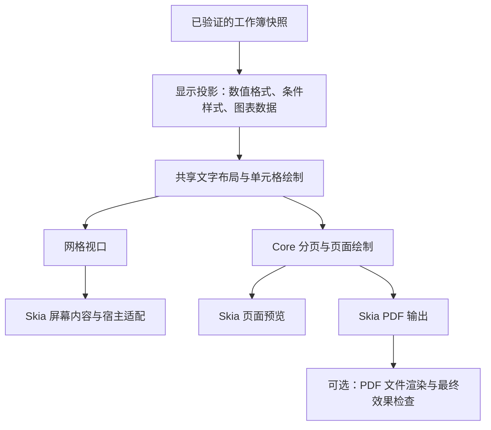

# SkiaSharp 引入方案：跨平台渲染、PDF 生成与预览

2026-11-02。状态：**目标设计，尚未实施**。本文依据当前源码和官方资料提出迁移方案；未引入 NuGet 包、修改运行路径或完成新的性能/跨平台验证。现有实现和证据仍以 [主网格迁移](24-main-grid-migration.md)、[XLSX 渲染](25-xlsx-rendering.md) 与 [E4 报表、打印与容量](57-e4-reporting-and-capacity.md) 为准。

## 1. 目标与决策

引入 SkiaSharp，建立不依赖 WPF、GDI+、Windows 图片解码和打印驱动的共享布局与绘制模块，为后续跨平台桌面提供可复用基础，并直接支持 PDF 输出与页面预览。

建议采用“共享文字布局与绘制 → PDF/页面预览 → 主网格 → 清理旧依赖”的顺序。当前 WPF 外壳作为过渡宿主，编辑、输入法和文档事务继续使用现有路径。PDF 是首个完整业务落点：可以较早证明新模块能在没有 Windows Desktop Runtime 和打印驱动的环境运行。

本方案的完成范围：

- 内容绘制、文字测量、图片处理和 PDF 生成有独立的 `net10.0` 实现；Core 保持纯 .NET，不引入 SkiaSharp。
- 网格、自动行高列宽、页面预览与 PDF 共用字体解析和单元格布局规则；屏幕与纸张允许采用明确的输出策略。
- PDF 直接生成文字、矢量和图片对象；不以整页截图作为默认输出。
- Windows 专属的上屏、输入、剪贴板、系统打印等行为收敛到宿主或平台适配器。
- 至少在一个非 Windows 平台实际执行无界面渲染与 PDF 验证；只在 Windows 编译 `net10.0` 不构成跨平台完成。

本轮方案不确定未来桌面框架，不承诺整应用已经跨平台，不扩展现有 XLSX/图表支持范围，也不把换引擎等同于性能提升。GPU 接入、通用 PDF 阅读器、PDF 编辑/签名、PDF/A、PDF/UA 和完整无障碍语义另立任务。

## 2. 当前依赖与迁移入口

| 部分 | 当前实现 | 迁移要求 |
| --- | --- | --- |
| 网格项目 | [QuickExcel.Grid.Wpf.csproj](../../QuickExcel.Grid.Wpf/QuickExcel.Grid.Wpf.csproj) 使用 `net10.0-windows`、WPF、Windows Forms | WPF 控件继续作为宿主；可复用绘制与几何逐步脱离此程序集 |
| 字体/GDI+ | [LetterGlyphTool](../../QuickExcel.Grid.Wpf/WriteableBitmapEx/LetterGlyphTool.cs) 创建 `System.Drawing.Font`；ClearType 字形使用 GDI+；DpiDetector 使用 `Graphics.FromHwnd` | 替换字体解析、测量、字形生成；DPI 由宿主传入 |
| 默认普通文字 | [FastGridSurface](../Controls/Grid/FastGridSurface.cs) 设置 `UseClearType = false`；[GrayScaleLetterGlyph](../../QuickExcel.Grid.Wpf/WriteableBitmapEx/GrayScaleLetterGlyph.cs) 使用 `FormattedText` 和 `RenderTargetBitmap` | 同时替换 WPF 字形栅格化；仅替换 ClearType 路径无法迁走当前主要文字绘制 |
| 位图与缓存 | [RetainedContent](../../QuickExcel.Grid.Wpf/Upstream/FastGridControl_RetainedContent.cs) 使用 WriteableBitmapEx、可见单元格位图和冻结 DrawingImage；NativeMethods 含 `msvcrt.dll` 调用 | 保留可见范围、局部失效和容量约束，迁移底层像素/绘制资源及内存操作 |
| 样式与图片 | [FastGridArtwork](../Controls/Grid/FastGridArtwork.cs) 使用 WPF DrawingGroup、FormattedText、BitmapDecoder | 提取样式绘制、富文本布局与解码接口，保留图片限制及诊断 |
| 自动尺寸 | [FastGridSurface.AutoFit](../Controls/Grid/FastGridSurface.AutoFit.cs) 分别使用普通字形和样式文字度量 | 与实际绘制使用同一布局结果，保留稀疏遍历和合并/隐藏处理 |
| 图表 | [ChartDrawing](../Controls/Grid/ChartDrawing.cs) 共用于网格和打印，依赖 WPF DrawingContext | 将已有基础图表绘制迁至共享模块，不新增图表语义 |
| 分页 | [PrintingLayout](../../QuickExcel.Core/PrintingLayout.cs) 已在 Core，以 1/96 英寸单位分页 | 直接复用；继续遵守纸张、区域、标题、隐藏和输出预算 |
| 页面与 PDF | [WorkbookPaginator](../Printing/WorkbookPaginator.cs)、[PdfExport](../Printing/PdfExport.cs) 使用 WPF、XPS、XpsPrint 和 Microsoft Print to PDF | 提取页面绘制；直接 PDF 生成；系统打印留在 Windows 适配层 |

“移除 Windows 依赖”指业务与可复用渲染模块不直接绑定 Windows API。SkiaSharp 仍使用各平台的原生图形/字体实现及原生库；这些依赖由后端和发行包管理，不要求底层完全不调用操作系统 API。

官方 WPF `SKElement` 本身仍通过 `WriteableBitmap` 呈现。它可以用于过渡宿主，但不能放进跨平台模块，也不能以安装 `SkiaSharp.Views.WPF` 作为去除 WPF 的验收依据。[官方实现](https://github.com/mono/SkiaSharp/blob/main/source/SkiaSharp.Views/SkiaSharp.Views.WPF/SKElement.cs)

## 3. 模块边界

以下为建议名称，尚未创建项目。实现时可合并小型适配类，但应保留依赖方向。

| 模块 | 目标框架/依赖 | 职责 |
| --- | --- | --- |
| `QuickExcel.Core`（现有） | `net10.0`，纯 .NET | 快照、样式、数字格式、锚点几何、分页与命令；不承载字体文件和 Skia 对象 |
| `QuickExcel.Rendering`（新增） | `net10.0`，依赖 Core | 平台无关的显示输入、文字布局契约、单元格/页面几何、输出选项和诊断 |
| `QuickExcel.Rendering.Skia`（新增） | `net10.0`，依赖 Rendering、SkiaSharp 及兼容的文字塑形/解码组件 | 字体解析、排版实现、单元格/图表绘制、图片处理、预览图和 PDF 输出 |
| WPF 适配层（现有 Desktop/Grid 内） | `net10.0-windows` | 渲染调度、DPI、上屏、滚动条、选区交互、TextBox/IME、系统打印 |
| `QuickExcel.Rendering.Test`（建议新增） | `net10.0`，不引用 Desktop/Grid/脚本 worker | 共享布局与无界面输出验证；可在目标非 Windows 平台执行 |
| PDF 文件渲染适配器（可选后续） | 独立接口，后端待定 | 解析最终 PDF、逐页渲染及文字位置，不参与工作簿计算 |



接口应围绕 `FontRequest`、`TextLayoutRequest`、`CellRenderInput`、`PageRenderPlan` 等明确数据设计，名称仅作示意。契约中不出现 `System.Windows`、`System.Drawing`、`FormattedText`、`Brush`、`BitmapSource`、Dispatcher 或窗口句柄。`SKCanvas` 等类型可在 Skia 实现层使用，不进入 Core 和通用契约；不为假设中的多个后端复制一套完整图形 API。

一个现有依赖需要单独处理：[ConditionalPresentation](../../QuickExcel.Infrastructure/Calculation/ConditionalPresentation.cs) 位于 Infrastructure，而 Infrastructure 引用了 Scripting 和 Windows 相关适配。新渲染模块不能为了获得条件样式而引用整个 Infrastructure。过渡期由组合根调用现有投影器，以按页/视口有界的显示输入传给渲染器；未来如拆出纯计算投影模块，再独立调整引用。禁止在渲染回调中启动重算或脚本 worker。

网格、预览、PDF 可共享原语与布局规则，但输入不同：网格处理视口/冻结区域，页面处理打印区域/重复标题。选框、光标、填充柄和编辑器不进入打印内容。读取快照与显示投影不改变 dirty、历史或文档修订。

## 4. 文字、坐标与图片契约

### 4.1 统一文字布局

首轮提取范围包括字体及东亚字体回退、普通/富文本 run、字重/斜体/装饰、换行、缩进、旋转、缩小填充、横纵对齐、数字格式填充字符及裁剪。布局结果供绘制和自动尺寸共同使用，避免测量与显示采用不同字号或不同字符宽度。

Skia 基础文字绘制不提供完整塑形。应使用兼容的 HarfBuzz 集成或经过验证的排版组件；塑形之外仍需明确字体分段、双向文本、断行和字素边界。不能延续逐 UTF-16 `char` 拼接字形的方式来宣称支持完整 Unicode。[Skia 文字说明](https://skia.org/docs/user/tips/#does-skia-shape-text-kerning)

字体策略必须明确：

- 使用工作簿解析后的字体请求，按已定义的回退顺序寻找字体；不把 Microsoft YaHei UI、Segoe UI 当作所有平台必备资源。
- 缺字/替代字体有可定位诊断；测试记录最终字体身份。固定测试字体及版本，使用允许再分发和 PDF 嵌入的字体资产。
- 采用相同字体与布局策略验证跨输出一致性；系统字体不同造成的度量变化单独记录，不承诺跨平台逐像素相同。
- 富文本必须保留 run 的继承字体、颜色及装饰。渲染迁移不触发 flatten，不修改原数据，也不放松现有富文本编辑保护。
- 中英文、组合字符、补充平面字符、混合方向和缺字体场景均进入夹具；复杂文字的实际支持子集以测试结果声明。

### 4.2 坐标体系

保留 Core 现有 1/96 英寸逻辑坐标和现有工作簿尺寸语义；字号 point 转逻辑单位仍为 `pt × 96 / 72`。不把列宽字符单位或图片 EMU 的持久化约定改成 Skia 像素。

屏幕由宿主传入工作表缩放和显示器 DPI。内容、选区、命中测试、编辑框和冻结分区共用变换与原点，禁止应用两次缩放。像素取整只在屏幕输出边界执行，不将取整后的几何写回文档。打印使用打印缩放，不受当前工作表缩放或窗口 DPI 影响。

PDF 页面使用 1/72 英寸单位，因此页面尺寸和绘制坐标统一乘 `72 / 96`；预览按目标 DPI 换算像素。PDF API 中的 DPI 参数控制需要栅格化的效果，不用于改变纸张物理尺寸。[SKDocument.CreatePdf](https://learn.microsoft.com/en-us/dotnet/api/skiasharp.skdocument.createpdf)

普通单元格与样式单元格应合并到同一内容绘制规则。屏幕网格线可以做设备像素对齐，打印边框使用逻辑线宽；不同输出策略须显式建模，不能继续依赖两层分别取整来维持对齐。

### 4.3 图片与图表

保留 PNG/JPEG/GIF/BMP/TIFF 的现有插入与显示范围。逐项验证所选 Skia 版本的解码覆盖、透明度、DPI 和多帧默认行为，特别是 TIFF；不能假定 Skia 解码器等同 WPF/WIC。缺失格式需要独立跨平台解码适配器，未补齐前不得将新路径替换为唯一生产路径。

沿用图片 1,600 万解码像素、现有输入/工作簿预算，以及锚点、裁剪和附件诊断规则。仅将解码结果用于显示；原图片字节及 XLSX/XLSQ 保存逻辑不随渲染器改变。图表继续覆盖已支持的簇状柱形、基础折线和饼图，系列来自当前快照，不以旧缓存掩盖不可用数据。

## 5. PDF 与预览设计

### 5.1 共享打印任务

从当前 `WorkbookPaginator` 提取不可变的打印任务：快照、表标识、可见行列、打印选项、分页、显示投影、警告、文件显示名和固定时间戳。页面内容按需构造并有界缓存，不预先生成所有页面的位图或全簿绘制指令。

保留 [E4 打印入口](57-e4-reporting-and-capacity.md) 的语义：先提交当前编辑并完成现有全量重算，失败/取消不进入预览；当前表仍受阻的公式继续拦截，不自动授予脚本权限。导出器只消费准备好的任务，不自行计算。网格中对旧缓存的显示规则不被误用为可打印的新结果。

未知绘图、不可解码图片、不可绘制图表、未支持的页眉页脚及批注打印继续通过统一的打印内容提示说明；省略只作用于该次输出投影。预览、PDF 和系统打印使用相同任务与警告集，不能各自静默丢弃不同内容。预览打开后即使工作簿变化，该任务也不混入新修订的数据。

### 5.2 直接生成 PDF

使用 `SKDocument.CreatePdf` 和逐页 canvas 输出。常规文字保持文字对象，边框和支持的图表保持矢量，原始图片按目标矩形绘制；受支持内容不能为了方便一律转轮廓或栅格图。[官方 PDF 后端](https://skia.org/docs/user/sample/pdf/)

所选绑定版本必须验证中文及塑形文字的 Unicode 映射、搜索/复制、字体嵌入/子集化。将 run 变为 glyph 序列时保留文本/cluster 信息，验证最终 PDF 的文字提取结果；仅视觉相似不能通过。Skia PDF 对部分效果会降级、栅格化或失去文字属性，应列出允许使用的绘制操作并针对实际版本验证。

写出流程保持唯一临时文件、完成关闭、结构校验、取消检查后再替换目标；失败不破坏已有目标文件。不能仅检查 `%PDF-` 文件头，应验证最终文件可解析、页数/尺寸正确及内容完整。临时文件与目标放在同一文件系统，按平台验证替换行为；保存失败及磁盘不足应清理本次临时资源。

继续限制 2,000 页和 2,000,000 格输出。现有 64 MiB 是 XPS 中间文件预算、60 秒是驱动等待上限，不能直接当成新 PDF 的等价内存/执行预算。P0/P1 必须登记新的输出字节、解码内存、页面缓存和取消检查粒度；不得因没有 XPS 而取消任务资源限制。原生单次调用不能中断时，明确取消延迟上界并限制单页工作量。

PDF/A、PDF/UA、结构标签、数字签名、加密及链接交互不由基础 PDF 写出自动保证；后续有明确需求时再选择文档级组件。现有单元格链接保持惰性，不因迁移隐式增加自动打开行为。

### 5.3 两种预览

| 能力 | 数据来源 | 建议实现与边界 |
| --- | --- | --- |
| 页面预览 | 同一打印任务和页面绘制 | 首期实现；Skia 按可见页面生成内容，支持缩放、页码、缩略图与按需加载 |
| PDF 文件预览 | 已生成或外部提供的 PDF 字节 | 后续可选；通过 PDF 解析/渲染引擎实现，验证实际字体嵌入、编码和最终效果 |

页面预览可与导出共用绘制逻辑，但不能因此认定最终 PDF 一定相同。自动验收仍须用独立引擎解析并渲染 PDF，再与预览比较。

PDFium 可作为文件预览候选，官方提供读取、解析和页面栅格化能力及多平台构建方式。具体 .NET 绑定、发行包、更新机制与功能范围在接入前单独评估；不在本方案中默认引入任意第三方包装器。[PDFium 官方说明](https://pdfium.googlesource.com/pdfium/+/refs/heads/main/README.md)

预览实现须具备可见页优先、有界缓存、缩放请求合并、旧请求取消和过期结果丢弃。PDF 文字选择、搜索、链接、辅助功能属于预览控件层，不能以“能画页面图片”宣称已具备。系统物理打印仍由平台适配器提交，设备边距、纸张和驱动行为独立验收。

## 6. 主网格迁移与资源管理

首期采用可无界面运行的 CPU 光栅后端建立功能基线，PDF 生成也不应要求 GPU 或窗口。WPF 宿主先验证像素桥接与提交成本；是否启用 GPU、选用何种互操作方式，待实测后决定。避免把新的实现绑定到单一 Windows GPU API。

迁移时保留以下行为：

- 仅访问可见区域和必要邻域，保持稀疏模型、冻结分区、隐藏行列、合并范围与超大单元格的有界处理。
- 内容与选区/编辑器分层；拖选仅改变覆盖层时不重算全部内容。水平拖动继续合并最新位置，结束时立即提交终点。
- 缓存区分布局结果与栅格结果。键包含快照/样式身份、字体、宽度、输出策略；依赖 DPI/缩放的结果必须加入对应比例并失效。
- 背景工作基于不可变输入，完成后校验任务代次；重绑、卸载、尺寸/DPI 变化或文档关闭后丢弃过期帧。
- `SKSurface`、字体、图片及相关原生资源明确归属并及时释放；缓存淘汰按字节及数量控制，统计原生内存而不只看托管分配。
- 不在多个线程同时绘制同一可变 surface；上屏缓冲区在合成器使用期间不得复写。具体共享或复制策略由 WPF 桥接原型验证。
- 编辑继续通过 `EditorController` / `DocumentSession`。原地址草稿、IME 组合门禁、显式公式粘贴、批量原子历史、保护和富文本规则保持。

替换 `FastGridArtwork` 与普通文字路径后再移除重复绘制。待全部调用迁走，删除不再使用的 GDI+/WriteableBitmapEx 代码、`msvcrt.dll` 直接导入及不必要的 `UseWindowsForms`。若仍复用 FastWpfGrid/WriteableBitmapEx 派生代码，保留相应版权与来源，不能因绘制后端改变而删除许可。

## 7. 阶段与退出条件

所有阶段当前均为待实施；依赖版本和质量门槛应在开始对应阶段时写入实施记录。

| 阶段 | 工作 | 退出条件 |
| --- | --- | --- |
| P0 基线与依赖验证 | 固定包组合；盘点字体/图片覆盖；采集当前报表和网格基线；确定资源预算 | Windows x64 与至少一个非 Windows RID 能加载所选原生库；文字、PDF 和现有图片格式有验证结果；缺口明确登记 |
| P1 共享模块与无界面输出 | 新建契约与 Skia 实现；统一文字测量；实现单元格/图片/基础图表及页面绘制 | 无 WPF/Infrastructure/脚本 worker 引用的测试程序，使用固定快照在 Windows 与选定非 Windows 平台输出 PNG/PDF；中文、富文本、单位换算和分页验证通过 |
| P2 PDF 与页面预览 | 桌面报表入口接入共享打印任务；替换直接 PDF 路径；实现按需预览；保留系统打印适配 | E4 声明范围无回退；预览/最终 PDF 页面归属、文字和几何一致；不安装 PDF 打印驱动仍可导出；失败/取消保留原文件 |
| P3 主网格 | 迁移普通/样式内容、图片、图表、自动尺寸及覆盖层绘制；宿主继续管理输入 | 网格相关功能、缩放/DPI、冻结/隐藏/合并与性能定向验证通过；无双重内容绘制或持续资源增长 |
| P4 依赖收尾 | 删除不再使用的旧绘制代码；更新来源、许可、发布及依赖检查 | 共享项目不依赖 Windows API；旧 GDI 字体/位图和 Windows CRT 调用不再被渲染使用；发布包与平台证据完整 |
| 后续独立工程 | 跨平台桌面外壳、PDF 文件阅读器、各平台打印及脚本隔离 | 各自方案与质量门禁；不计入 P0–P4 的完成声明 |

P1 的无界面测试可直接构造 Core 快照和已解析的显示输入，不应为了加载测试工作簿而带入 Desktop 组合根或脚本启动。完整文件加载/计算链的跨平台拆分另行推进；应清楚区分“渲染模块跨平台”与“完整应用跨平台”。

阶段性接入允许通过开发配置选择旧/新后端，便于同一夹具比较和回退。选择应以一次视口或打印任务为单位；新 PDF 路径失败时报告错误，不静默改走 Windows PDF 驱动。默认切换前完成对应阶段验收，不维护长期分叉的业务绘制规则。回退不涉及文件格式、工作簿数据或脚本权限迁移。

## 8. 验证计划

按修改区域运行定向测试，不为每个切片执行完整回归。性能基准与测试分开运行，保留冷启动、失败和最终样本，不挑选最佳结果替代最终证据。

| 维度 | 必须覆盖 | 通过标准 |
| --- | --- | --- |
| 模块依赖 | 项目引用、NuGet 传递依赖、发布内容 | Core 无 Skia；共享渲染无 WPF、GDI+、Windows Desktop 及脚本 worker 依赖 |
| 文字/尺寸 | 中英文、缺字体、富文本、旋转、换行、缩小填充、自动尺寸 | 测量与绘制一致；无缺字、断字或非预期裁剪；字体替代有记录 |
| 页面 | 区域、多区域、重复标题、两种顺序、隐藏/筛选、手动分页、适页、页眉页脚、黑白 | 与固定任务的页数、行列归属及布局一致，保持现有支持/诊断边界 |
| PDF | 中文/英文提取、搜索复制、嵌入字体、页面尺寸、图片与矢量 | 独立解析可打开；文字正确；不是整页图片；纸张误差可沿用现有 0.2 pt 阈值 |
| 预览与 PDF 对照 | 用独立引擎渲染最终 PDF，按相同 DPI 比较 | 逐页验证内容、几何及视觉；抗锯齿容差单独制定，不能只看全页像素差占比 |
| 网格 | 100%/125%/150%/200% 缩放、96/144/192 DPI、跨屏、冻结、隐藏、合并、宽列、选区和编辑框 | 同原点、同变换；内容/命中/编辑对齐；真实跨屏与 IME 单独取证 |
| 资源与失败 | 多页、大图、快速滚动/缩放、取消、关闭、缺库、解码失败、磁盘不足 | 内存/缓存有界；无过期结果覆盖；已有目标文件保持；临时资源回收 |
| 性能 | 首屏/冷字体、持续滚动、输入排队、PDF 首页面/总时间、原生/托管内存 | 在固定硬件和同等工作量下对照 P0 预先登记预算；不把 WPF 提交节拍称为物理显示延迟 |

同字体的跨平台布局比较与不同系统字体的产品检查分开进行。新旧引擎之间不要求所有字形边缘逐像素一致，但差异必须能归因，不能以抗锯齿差异掩盖换行、漏字、错页或附件缺失。当前 [verify-e4-visuals.py](../../scripts/verify-e4-visuals.py) 已检查页数、文字、纸张和 DPI；迁移时扩充中文、字体和最终 PDF 渲染对照，不把现有 PNG 检查冒充独立 PDF 视觉验证。

可复用的 Windows 定向入口如下；这些命令是后续实施验证入口，本次方案编写未执行：

```powershell
dotnet build .\QuickExcel.slnx -c Release --artifacts-path .\artifacts\build -v minimal
dotnet test .\QuickExcel.Core.Test\QuickExcel.Core.Test.csproj -c Release --artifacts-path .\artifacts\build --filter 'FullyQualifiedName~E4ReportingTests|FullyQualifiedName~WorksheetPrintingTests' -v minimal
.\scripts\test-m5-grid.ps1 -PackageDirectory artifacts\build\bin\QuickExcel.Desktop\release -Mode Reporting
.\scripts\test-m5-grid.ps1 -PackageDirectory artifacts\build\bin\QuickExcel.Desktop\release -Mode GridIntegration
.\scripts\test-m5-grid.ps1 -PackageDirectory artifacts\build\bin\QuickExcel.Desktop\release -Mode Workspace
.\scripts\test-m5-grid.ps1 -PackageDirectory artifacts\build\bin\QuickExcel.Desktop\release -Mode Interaction
```

P1 新建渲染测试项目后补充其定向命令和非 Windows CI 入口。P3 再单独运行 `HorizontalScrollBenchmark`、`FastGridBenchmark`、`FastGridDragBenchmark`，包含真实不等宽列工作簿。每次仅选择受影响模式；不得使用 `All` 代替定向选择。所有托管 build/test/run/publish 使用 `--artifacts-path`，日志、PDF、PNG、字体清单及原始样本保存在本仓库独立 artifacts 子目录。

## 9. 包、平台与剩余 Windows 依赖

P0 按实施时可用的稳定版本固定 `SkiaSharp`、可选 `SkiaSharp.Views.WPF`、`SkiaSharp.HarfBuzz` 与原生资产的兼容组合。包号不一定全部相同，应根据依赖约束和原生 ABI 验证；禁止浮动版本和仅以 NuGet 安装成功判断可用。[SkiaSharp 包](https://www.nuget.org/packages/SkiaSharp)、[HarfBuzz 集成包](https://www.nuget.org/packages/SkiaSharp.HarfBuzz)

初始平台验证为 Windows x64 加 Linux x64 无界面任务；macOS arm64 等后续目标分别补齐实际运行证据。记录 Linux 发行版/运行库、字体发现方式、原生依赖、包版本和架构，不把某一 Linux 包视为所有发行版通用。无界面任务不得要求显示服务器或显卡上下文。

发布增加原生库存在性和加载冒烟、第三方许可证与来源记录、依赖升级后的输出回归。按实际版本验证字体/图片组件许可和再分发条件。测试字体、测试工具与 PDF 验证引擎是否随产品发布必须明确区分；绘图库和预览依赖不得无故复制进 ScriptWorker 的只读载荷。

| 剩余依赖 | 后续处理 |
| --- | --- |
| WPF 窗口、控件、输入法、剪贴板和辅助功能 | 跨平台桌面框架选型与宿主迁移；新渲染模块可复用，输入与无障碍仍需实现 |
| System.Printing、PrintDialog、实际打印机 | 各平台打印适配；直接 PDF 导出不再依赖打印队列 |
| AppContainer、Job、Windows 令牌/ACL 与崩溃恢复 | 平台隔离实现单独设计并验证等效边界；禁止同权限或进程内脚本回退 |
| QuickJS 当前 Windows x64 原生构建与加载 | 各平台原生构建、部署与 smoke，保持来源、哈希和许可证 |
| DPAPI 脚本证书信任存储 | 平台安全存储适配及迁移方案，不降级为明文信任配置 |

上述工作不阻塞无脚本、无界面的渲染模块验证，但阻塞对应平台整应用能力的完成声明。现有 M4/M6、真实 IME、辅助功能和物理打印门禁不因 Skia 切换而关闭。

## 10. 首个实施切片

首个切片限定为 P0 和 P1 的最小闭环：创建共享契约及 Skia 实现项目，以固定快照生成包含中英文、富文本、合并单元格、图片和基础图表的多页报告；输出 PNG 与具有正确文字提取结果的 PDF；在 Windows x64 和 Linux x64 实际运行并保存证据。

闭环通过后接入现有报表入口，再迁移主网格。后续实施记录应逐项列出实际包版本、平台、支持矩阵、相关测试、原始性能样本与未通过项；本文仍保留方案身份，不以规划中的项目或接口作为已交付能力。
