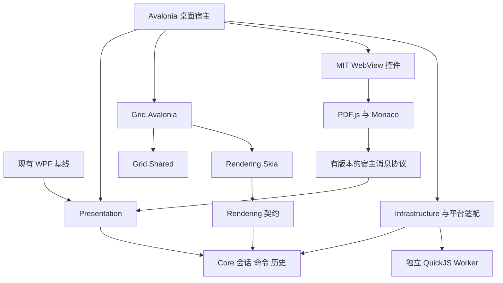

# QuickExcel Avalonia 迁移方案与实施计划

2026-11-02 制定，2026-11-03 更新。状态：**A0–A5 Windows 工程验证与切换完成，A7 WPF 收尾完成；A6 Linux 有受测 Ubuntu 候选，macOS worker 未实现；实机验收按用户要求延期**。当前默认入口为 Avalonia，实际实现与证据见 [63 号实施日志](63-avalonia-implementation-log.md)、[67 号平台记录](67-avalonia-platforms.md)及 [68 号收尾记录](68-avalonia-retirement.md)。以下保留迁移方案、阶段顺序与验收要求；各阶段当时的状态不代表当前版本仍有相同缺项。

迁移分为两个独立交付目标：**Windows 上的 Avalonia 功能对齐**，以及 **macOS/Linux 的完整平台支持**。前者不得降低当前功能和脚本隔离；后者必须完成原生库、打印、用户数据保护和脚本沙箱适配，不能以窗口能够打开作为完成依据。

## 1 目标与约束

1. 使用公开源码、MIT 许可的 Avalonia 主框架和通过许可证核验的开源配套组件；不采用 Avalonia XPF，不引入依赖付费授权、订阅或试用密钥的 Avalonia 运行时、控件或构建依赖。
2. 保留 Core、DocumentSession、存储、计算、共享 Skia 渲染及现有文件契约。界面迁移不改变公式语义、脚本 API、文件版本和撤销事务边界。
3. 将主网格的视口、选区、命中和输入行为迁到 Avalonia，继续复用已有内容渲染；不以普通 DataGrid 取代现有电子表格交互能力。
4. PDF.js 和 Monaco 作为专门的网页界面组件；主网格继续采用原生 Avalonia 控件和共享渲染，不在本计划内改成网页电子表格。
5. Windows 先完成当前产品能力对齐。macOS/Linux 独立列出支持矩阵和退出条件，不把 Windows 的测试结果扩展为其他平台证据。
6. 现有 WPF 程序保留为迁移期可运行基线，直到切换验收完成；同一修复尽量落入共享层，避免长期维护两套业务规则。
7. 所有源码、文档、测试和产物留在 QuickExcel 仓库；不读取或复制 `../ExcelIO` 的实现来完成迁移。

既有 [M4 隔离](15-m4-os-isolation-adr.md)、[恢复与部署](16-m4-recovery-and-deployment.md)、M5/M6 以及 [E5](26-excel-compatibility-roadmap.md) 的未关闭事项保持独立。本计划不把换 UI 框架等同于性能、无障碍或安全门禁已经完成。

## 2 开源版本与许可证准入

### 2.1 组件选择

| 组件 | 选择与用途 | 许可证及准入条件 |
| --- | --- | --- |
| Avalonia、Avalonia.Desktop、Avalonia.Themes.Fluent | 桌面宿主、基础控件、Fluent 主题 | Avalonia 公开源码采用 MIT；锁定实际使用包与对应源码版本 |
| Avalonia.Skia | Avalonia 绘制后端 | 同属开源框架；必须验证与现有 SkiaSharp/HarfBuzzSharp 的托管和原生依赖兼容 |
| Avalonia.Controls.WebView | 优先验证的官方 WebView 控件 | 当前公开仓库为 MIT；只使用 Avalonia 包，不引用 `Avalonia.Xpf.Controls.WebView` |
| PDF.js | PDF 显示、页导航、搜索、缩略图、文本选择 | Apache-2.0；保留 LICENSE、适用的 NOTICE 和修改记录，不将它描述为 MIT |
| Monaco Editor | JavaScript 编辑、语言服务、补全和诊断展示 | MIT；本地打包编辑器、语言服务 worker、语言资源及依赖许可 |
| FastWpfGrid 已复用源码 | 提取几何、范围和交互算法 | 继续保留仓库内原 MIT 版权声明和来源记录 |
| 现有 Rendering.Skia 与 RichTextKit | 文字、图片、图表、PDF | 沿用 [60 号记录](60-skia-rendering-and-pdf-implementation.md) 和现有来源清单 |

许可证依据：[Avalonia MIT 原文](https://raw.githubusercontent.com/AvaloniaUI/Avalonia/master/licence.md)、[官方 WebView MIT 原文](https://raw.githubusercontent.com/AvaloniaUI/Avalonia.Controls.WebView/main/LICENSE)、[PDF.js Apache-2.0 原文](https://raw.githubusercontent.com/mozilla/pdf.js/master/LICENSE)、[Monaco MIT 原文](https://raw.githubusercontent.com/microsoft/monaco-editor/main/LICENSE.txt)。上述链接描述核对时的上游状态；实施时将选定 tag/commit、NuGet/npm 内容哈希和对应许可证一起登记，不能用移动分支代替发行包核验。

“Avalonia 使用 MIT 版本”不表示整个软件依赖树都采用 MIT。WebView2 Runtime、系统 WebKit、字体、编解码器及其他原生组件分别遵守自身条款。它们不应因通过 MIT 控件加载就被错误标记为 MIT。

### 2.2 版本冻结与兼容性门槛

首轮可行性验证候选为 Avalonia **12.1.4** 同系列框架包和 `Avalonia.Controls.WebView` **12.1.1**；这是一组待验证的固定候选，不是已验证组合，也不代表必须追随最新版本。依据为公开的 [Avalonia.Skia 12.1.4 包信息](https://www.nuget.org/packages/Avalonia.Skia/12.1.4) 与 [WebView 12.1.1 包信息](https://www.nuget.org/packages/Avalonia.Controls.WebView/12.1.1)。PDF.js、Monaco 版本在 A0 按目标浏览器能力选定，进入正式接入前必须填写精确版本和锁文件。

当前 QuickExcel 固定 SkiaSharp **4.154.0**、HarfBuzzSharp native assets **14.2.1.400**；候选 Avalonia.Skia 的公开依赖下界处于 SkiaSharp 3.119.4/HarfBuzzSharp 8.3.1.3 系列。NuGet 能还原并不证明跨大版本 API、ABI 或运行期行为兼容。

A0 必须同时验证 Avalonia 自身文字/控件、共享单元格绘制、PDF 输出、RichTextKit 排版和原生库加载，记录每个 RID 最终解析版本及实际加载路径。不能通过忽略警告、复制两套同名 native DLL、私自降级渲染依赖或禁用校验来宣布通过。若不兼容，先选择兼容的 MIT 发行组合；必要的上游适配补丁必须有来源、差异、许可和回归记录。组合未通过前暂停主界面切换，保留 WPF 交付路径。

新增依赖需满足：公开包源可还原、无授权服务或试用要求、许可证随包、传递依赖有清单、release 不含设计器和测试载荷。Avalonia 框架包尽量统一版本，WebView 按实际声明的依赖范围匹配，不按包名猜测版本一致性。原生库和 npm 资源都进入发布身份清单；不使用浮动版本或运行时 CDN。

## 3 迁移起点与模块清单

迁移起点是 [60 号 Skia 实施记录](60-skia-rendering-and-pdf-implementation.md)，而不是 59 号方案中的旧实现描述。下表保留迁移时的模块状态与动作；旧 WPF 源码现已移除，由 `avalonia-wpf-baseline-20261102` 标签保留，当前生产结构见仓库 README 与 68 号记录。

| 迁移时的模块或入口 | 迁移时状态 | 迁移动作 |
| --- | --- | --- |
| `QuickExcel.Core` | 纯 .NET 领域、会话、命令、历史和端口 | 直接复用，保持无 UI 和 native 引用 |
| `QuickExcel.Infrastructure` | `net10.0`；存储/计算可复用，但脚本启动和信任存储含 Windows 实现 | 分离平台能力选择；不能因 TFM 是 net10.0 就宣称整项目可跨平台执行 |
| `QuickExcel.Rendering` / `Rendering.Skia` | 已共享文字、图片、图表、分页输出和直接 PDF | 复用；增加 Avalonia 上屏适配和目标 RID 的真实运行验证 |
| [EditorController](../../QuickExcel.Presentation/Editing/EditorController.cs) | 统一命令入口，主体不依赖 WPF | 提取至共享表现层，保留校验、预期修订和单事务提交 |
| [Interaction](../../QuickExcel.Presentation/Interaction/GridInteraction.cs) 与相关规则 | WPF-free，A1 已提取至 Presentation，Core.Test 使用项目引用 | 迁入正式共享程序集，测试改为项目引用，避免两份源文件漂移 |
| [IGridSurface](../../QuickExcel.Presentation/Grid/IGridSurface.cs) | 已有视图边界，接口本身无 WPF 控件类型 | 复用契约，按实际需要扩展异步编辑协调；具体控件生命周期留在宿主 |
| `QuickExcel.Grid.Wpf` | 仍有 WriteableBitmap、Dispatcher、WPF 输入及控件依赖 | 提取可复用几何和行为，新增 Avalonia 控件；不能直接改项目名称后作为跨平台网格 |
| 旧 WPF `FastGridArtwork`（见基线标签） | Skia picture 内容加 WPF DrawingGroup/BitmapSource 上屏 | 保留内容构建与缓存失效规则，重写上屏和资源所有权 |
| 旧 WPF `MainWindow` 与各 partial（见基线标签） | 工作区、菜单、事件协调和 UI 状态混合 | 分切片迁移命令/状态与视图，保留功能对照清单 |
| 旧 WPF `WorkbookPaginator`（见基线标签） | WPF 文档、预览缓存、系统打印适配 | 抽出与 UI 无关的打印会话；Avalonia 预览直接接 PDF.js |
| 旧 WPF 脚本页（见基线标签） | TextBox、模块切换、同步草稿提交和错误定位 | 在 Avalonia 内直接接 Monaco，重做有确认的异步草稿同步 |
| [QuickJsSession](../../QuickExcel.Scripting/QuickJsSession.cs) | 当前显式限制 Windows x64，项目复制 quickexcel-js.dll | 按 RID 构建/加载原生桥，保持 QuickJS 源版本、SHA-256 和许可证 |
| [WorkerProcess](../../QuickExcel.Infrastructure/Scripting/WorkerProcess.cs) | Windows AppContainer、Job、显式句柄和恢复记录 | Windows 完整复用；其他平台单独实现等效能力约束 |
| [证书信任存储](../../QuickExcel.Infrastructure/Scripting/ScriptCertificateTrustStore.cs) | DPAPI CurrentUser 保护 | 新增平台保护端口；不把 Windows 信任数据解密迁成明文 |
| `scripts`、Desktop Diagnostics、Core.Test | 包含 WPF 专项、Windows fixture、Excel COM 和通用测试 | 保留 Windows 证据路径；新增 Avalonia/平台专项，按能力拆分构建和执行 |

## 4 目标模块与依赖方向

Presentation 和 Grid.Shared 已在 A1 创建，Grid.Avalonia 和 Desktop.Avalonia 已在 A2 创建。Web 项目从 A0 探针逐步扩展为 A4 正式组件。

| 目标模块 | 目标框架与职责 | 依赖约束 |
| --- | --- | --- |
| `QuickExcel.Presentation` | `net10.0`；编辑控制器、工作区状态、草稿协调、平台端口、提示与命令状态 | 依赖 Core，必要时依赖 Rendering 契约；不引用 WPF、Avalonia、WebView 或具体 Infrastructure |
| `QuickExcel.Grid.Shared` | `net10.0`；尺寸索引、视口映射、范围/合并几何、命中规则、滚动与交互状态 | 无 UI/native 类型；复用当前算法及其许可证，避免变成第二套领域模型 |
| `QuickExcel.Grid.Avalonia` | `net10.0`；网格控件、输入事件、编辑框、可访问性和上屏 | 依赖 Grid.Shared、Presentation 和 Rendering.Skia，所有写入通过注入命令入口 |
| `QuickExcel.Desktop.Avalonia` | `net10.0`；窗口、视图、Fluent 主题、WebView、平台组合根 | 选择 Infrastructure 及平台服务；不引用旧 Desktop 或 Grid.Wpf |
| `QuickExcel.Web` | TypeScript/HTML/CSS 源码、PDF.js/Monaco 包装、消息协议、前端测试 | npm 锁文件入 Git；构建输出进入 artifacts；产品运行时不要求 Node.js |
| 现有 Infrastructure 平台目录 | 存储/计算保持共享；脚本、安全存储、打印等按能力组织 | Win32 P/Invoke 只能在 Windows 能力路径调用；不得在静态初始化时加载 Windows API |



平台端口按实际调用点提取，包括文件选择、剪贴板、用户目录、窗口关闭协调、系统打印、用户数据保护及 WebView 资源加载。UI 事件在宿主线程执行；计算、文件 IO、PDF 生成使用已有异步工作与取消模式，结果回到会话时继续核对文档身份、修订和代次。

通用 `net10.0` 项目不能直接引用仅 `net10.0-windows` 的 WPF 打印程序集。若 Windows 过渡期保留此类适配，必须采用独立 Windows 入口/辅助进程或清晰的目标框架拆分；最终共享宿主不得偷偷携带 WPF 依赖。平台服务的返回类型不得包含 WPF `Window`、`Brush`、`BitmapSource` 或 Avalonia 控件。

迁移期不同时升级 MVVM 框架、计算器、文件格式和脚本协议。先迁出已有明确可复用的类，再逐步解耦 MainWindow；不为每个事件建立一层空接口。

## 5 主网格迁移方案

### 5.1 绘制与资源生命周期

继续使用稀疏工作簿快照和可见范围绘制。冻结区与滚动区使用相同内容模型，选区、引用高亮、填充预览和编辑框独立失效。每格创建 UI 控件、枚举整个大选区、随滚动扫描完整工作表均不允许。

首轮采用可验证的 Skia 输出与 Avalonia 图像/绘制操作适配，明确 DIP、物理像素、DPI 和缩放转换。若使用 Avalonia 提供的 Skia 绘制租约，只使用受支持生命周期，禁止跨帧保留租借的 Canvas/Surface。提交合成器的图像不可再被后台线程复写。

保留快照修订、样式、字体、尺寸、视口、DPI 和缩放引起的缓存失效规则。卸载窗口、替换文档、切换工作表和渲染失败均释放本次拥有的 picture、位图、字体引用及订阅；共享资源按明确所有者释放。GPU 直绘作为性能验证后的实现选项，不以“双方都用 Skia”推断零复制或更快。

### 5.2 几何与交互

| 功能组 | 必须保持的行为 |
| --- | --- |
| 视口与尺寸 | 冻结行列、平滑横纵滚动、过滤/隐藏映射、超宽列/超高行、合并格、缩放及行列尺寸预览 |
| 选择与导航 | 单格/矩形/多范围选择、键盘扩展、合并选区规范化、拖选自动滚动、行列标题选择、边界坐标定位 |
| 单元格与公式栏编辑 | 原单元格拥有草稿，焦点切换不把草稿提交到新格；Enter/Tab/Escape 和只读/保护逻辑保持 |
| 公式编辑 | 引用高亮、点选插入、引用拖动、绝对/相对引用和显式公式粘贴策略 |
| 剪贴板与填充 | 内部格式与纯文本、复制/剪切/选择性粘贴、填充序列、引用调整和一次撤销；过滤行映射不能静默变化 |
| 内容与样式 | 富文本继承、链接/批注标记、合并、条件格式、数字格式、图片锚点、三类已有图表 |
| 结构与辅助操作 | 插删行列、稳定排序、筛选、分组/分类汇总、表格、自动尺寸、工作表管理和统计 |

结构、剪贴板和覆盖输入必须继续遵循 [35](35-xlsx-preserved-formulas.md)、[36](36-xlsx-rich-text-links-and-notes.md)、[40](40-internal-clipboard.md)、[41](41-fill-and-series.md)、[42](42-formula-entry-and-navigation.md) 的附件、公式和保护规则。迁移不解除既有拒绝条件，不丢弃未知内容诊断。

### 5.3 输入法与可访问性

中文组合输入由 Avalonia 原生编辑控件承接，按实际 composition 生命周期实现门禁；不能只把 WPF `TextCompositionManager` 事件名替换为普通 TextInput。覆盖候选窗定位、组合期间 Enter/Escape、单元格/公式栏往返、滚动与缩放、切换窗口和失焦。

网格需提供当前格、选区、行列标题、值、只读/保护状态和错误的可访问性信息，避免为整张大表生成无界可访问性对象。菜单、对话框、预览和脚本编辑器均需要键盘可达、可辨识焦点和辅助技术验证。合成事件和 headless 测试不能代替真实 OS 输入法与屏幕阅读器检查。

## 6 桌面工作区与应用行为

Avalonia 官方迁移文档明确指出样式、属性系统、模板和事件存在差异，应按实际行为迁移，而不是批量替换 XAML 命名空间。[WPF 迁移指南](https://docs.avaloniaui.net/docs/migration/wpf/)

| 工作区部分 | 实施要求 |
| --- | --- |
| 启动、文件与关闭 | 新建/打开/最近文件、另存/导出、未保存提示、取消操作、窗口关闭等待；IO 失败保留编辑 |
| Ribbon 与命令 | 采用 MIT 的 Fluent 主题和基础控件组合迁移现有选项卡/分组；保留命令可用性、快捷键、窄窗口与高 DPI 行为 |
| 工作表与视图 | 导航位置、标签、可见性、冻结、缩放和保存的 workbook views；导航不误标 dirty |
| 格式与数据工具 | 字体、对齐、边框、数字格式、查找替换、筛选排序、数据清理、条件格式、验证、名称及表格 |
| 对象与报表 | 图片/图表管理、批注、页面设置、打印区域、标题、分页和输出提示 |
| 脚本与诊断 | 模块管理、角色、授权/撤销、签名信任、UDF/actions 执行、日志和错误跳转 |
| 设置与恢复 | 设置格式可迁移、有版本、可回退；测试目录隔离；不把现有手动恢复入口宣称为自动恢复完成 |

样式先保持功能和布局可用，再统一 Fluent 视觉。图标可以复用已有许可覆盖的图形资源或选择经过核验的 Avalonia 图标包，不能直接引用 `FluentIcons.Wpf`。不为获取 Ribbon 而引入商业控件集。

文件选择接口应处理取消、不可写目标和平台返回的存储对象；需要本地路径的现有存储器必须明确验证能力，不能把所有 URI 当路径。保存继续使用 `IVersionedWorkbookStorage.SaveChecked` 和打开/保存时的指纹，保留外部冲突处理。Windows/macOS/Linux 的大小写、Unicode 路径、权限、文件锁和原子替换语义分别验证。

## 7 共享 WebView 基础

### 7.1 平台适配

优先使用通过 A0 的 MIT `Avalonia.Controls.WebView`。当前官方方案在 Windows 使用 WebView2、macOS 使用 WKWebView，Linux 按可用库选择 WPE WebKit/WebKitGTK；Linux 还涉及原生库和显示会话条件。[官方平台要求](https://docs.avaloniaui.net/docs/app-development/embedding-web-content)

宿主封装创建/销毁、加载完成、资源请求、消息、导航拦截、进程失败、焦点和缩放。PDF 预览与脚本编辑器使用独立页面及独立消息能力集；同一 WebView 不能通过临时导航在两者之间切换而遗失编辑状态。共享的是宿主封装和资源构建，不要求共享一个控件实例。

A0 验证菜单/弹窗覆盖、裁剪、拖动分隔条、DPI、键盘穿透与输入法候选窗，不能假设原生子窗口与 Avalonia 合成层完全一致。某个平台仅能打开独立浏览器窗口，不等同于内嵌脚本页验收通过。

### 7.2 本地资源与离线运行

HTML、CSS、JS、worker、字体映射、语言资源和图标全部随包提供。Windows 优先验证虚拟 HTTPS 源；其他平台由资源适配器提供满足同源、模块和 Web Workers 要求的加载方式。不得假设任意自定义 URI scheme 都支持 worker；若候选平台需要受限的 loopback 服务，需在 A0 明确监听范围、随机令牌、请求路径白名单和生命周期，再固定一种实现。

不把工作簿目录映射为可浏览的 Web 根目录。资源只能通过清单中的逻辑名称访问，PDF 使用会话内不可猜测 ID，拒绝路径穿越和过期请求。页面不依赖外网、CDN 或登录，禁用不需要的远程导航、弹窗和权限申请。为应用资源和 worker 制定可测试的 CSP；工作簿标题、诊断和源码使用文本/结构化数据接口呈现，不能作为 HTML 注入。

Monaco 和 PDF.js 的 worker 不能依赖普通 `file://` 加载；遵循 [Monaco 集成说明](https://github.com/microsoft/monaco-editor) 与 [WebView2 本地内容说明](https://learn.microsoft.com/en-us/microsoft-edge/webview2/concepts/working-with-local-content)。采用 ESM 构建，不从已弃用的 Monaco AMD 集成开始新实现。

### 7.3 消息协议与错误恢复

消息采用 JSON 序列化和明确 DTO，包含协议版本、消息类型、请求 ID、文档/视图实例 ID、代次及必要修订号。建议首版区分 `ready`、`setDocument`、`textChanged`、`flushDraft`、`draftAck`、`setDiagnostics`、`requestPrint`、`requestExport` 和 `dispose`。实际名称可随实现调整，语义必须有契约测试。

宿主检查消息来源、能力、结构、长度和状态；禁止通用“调用任意 .NET 方法”桥，禁止将源码拼入 `ExecuteScript`。第一版桥接普通消息上限建议为 256 KiB，大内容按限额分块并整体校验；脚本总量仍服从当前约 1 MiB 的模块源码预算，不扩大领域限制。PDF 二进制走资源读取/流，不以大段 Base64 经过 JSON 桥。WebView 消息协议独立于现有 worker IPC 协议 4，不复用其版本号和 16 MiB 限额。[宿主消息安全建议](https://learn.microsoft.com/en-us/microsoft-edge/webview2/concepts/security)

超时、页面重载、窗口关闭、浏览器进程退出和旧实例消息均有确定处理。已确认草稿在 .NET 侧保留；未确认编辑不得显示为已保存。页面失败时显示恢复入口和明确草稿状态，不静默重建空编辑器。WebView 与 user-data/profile 目录按会话/应用管理，清理不跟随重解析点、不删除其他实例仍使用的资源。

## 8 PDF.js 打印预览

### 8.1 数据路径

沿用打印前提交草稿、重算和计算状态检查，受阻公式继续禁止打印。以不可变快照构建 PrintJob，Skia 生成 PDF，PDF.js 加载该 PDF。导出同一次预览时使用该不可变任务的内容；设置或工作簿变化后显式重建任务，不能用旧预览代表新内容。

从 `WorkbookPaginator` 提取平台无关的打印会话，管理 PrintJob、生成任务、取消、临时 PDF 和资源租约。当前 `SkiaReport.WritePdf` 按完整文档生成并在关闭后验证，因此第一版展示生成进度，完成后加载预览；不宣称可以在最终 PDF 未闭合时立即查看第一页。用户连续修改页面设置时取消旧生成，并校验代次后发布结果。

### 8.2 Viewer 与资源预算

基于 PDF.js 现成 Viewer 做样式和功能裁剪，提供连续页、缩略图、页码跳转、搜索、选择复制、适合整页/宽度及缩放。只保留打印预览需要的功能，关闭任意打开外部 PDF、PDF 脚本、表单修改、批注编辑和自动外链导航；工作簿链接继续惰性。[PDF.js 分层说明](https://mozilla.github.io/pdf.js/getting_started/)

沿用现有分页 2,000 页/2,000,000 格、单页 100,000 格/2,000,000 UTF-16 单位、PDF 128 MiB 和单图 16,000,000 像素上限。PDF.js 按可见页调度和回收 canvas；目标同时保留不超过 8 个完整页面画布、画布像素合计不超过 64 MiB，缩略图另设小额上限并计入总账。高 DPI/高缩放下使用明确的渲染分辨率限制，不能预先渲染全部高分辨率页面。该预算须通过 Viewer 的实际实现验证，不因为现有 WPF 缓存已有限制就视为自动继承。

浏览器解码、文本层、PDF 字节、GPU 和 native 内存不等于 canvas 字节数；A0/A4 测量完整进程树，并记录峰值与关闭后的稳定值。大文件支持按资源读取，必要时支持 HTTP Range；不假定非线性化 PDF 只需读取第一页对应的少量字节。[PDF.js 支持与性能边界](https://github.com/mozilla/pdf.js/wiki/Frequently-Asked-Questions)

### 8.3 导出与物理打印

PDF 导出保留同目录临时文件、flush、独立解析验证、取消检查和原子替换，失败不得破坏已有目标。打印预览临时文件与最终导出文件分开管理，预览关闭后先取消并等待在途读取/生成，再释放文件。

物理打印通过宿主的打印服务发起，明确页范围、纸张、方向、缩放、边距和黑白设置。首版不把 PDF.js 的 `window.print()` 当作所有平台的统一打印合同；系统打印对话框、驱动和页面转换各有平台差异。Windows 若沿用现有有界栅格打印策略，保持同一 PrintJob 与最高 300 DPI 的既有规则并重新验证；macOS/Linux 的原生打印适配在 A6 单独验收。

验证预览和输出的文字、页归属、纸张及局部视觉，不要求不同渲染器抗锯齿逐像素相同。复用 E4 五页样本和独立 PDF 解析/渲染检查；缺字、裁剪、字体替代和分页变化都必须可定位。

## 9 Monaco 脚本编辑器

每个逻辑模块对应稳定 URI 的 Monaco model，模块切换保留各自草稿、撤销栈、光标和滚动位置。模块 ID、路径、入口和角色继续由当前脚本契约管理；WebView 不能自行枚举磁盘目录或解析任意 npm/网络模块。

首版提供 JavaScript 高亮、行号、缩进、括号匹配、查找替换、基础格式化、补全、参数提示、错误标记及定位。通过 `.d.ts` 和语言服务配置描述 QuickExcel v1/v2 的真实 API、`workbook/actions` 和声明的逻辑模块；移除运行时没有的 DOM/Node 全局提示。静态诊断与 QuickJS 实际运行错误分开显示，最终执行语义仍由当前 QuickJS 版本决定。[Monaco 类型声明扩展](https://microsoft.github.io/monaco-editor/typedoc/interfaces/languages_features_typescript_register.LanguageServiceDefaults.html)

草稿同步采用以下顺序：

1. 编辑消息带 model/document 身份、前置版本和新版本；宿主维护有界草稿，不把每个按键直接写成工作簿历史命令。
2. 保存、切换模块角色、运行、签名或关闭前，发出 `flushDraft` 并等待对应版本确认；禁止同步阻塞 UI 线程等待 JavaScript。
3. 获得最新草稿后，调用 EditorController/DocumentSession，保持旧的授权撤销、修订、校验和撤销事务语义；内容未变化不发命令。
4. 确认失败或版本不匹配时保持编辑上下文，允许重试/取消；不能退回旧文本并报告保存成功。
5. 运行结果按文档、模块和源码版本定位；源码已变时将诊断标为旧结果或丢弃，不把错误标在另一模块上。

中文组合输入、全局快捷键与编辑器快捷键的优先级、只读模式和屏幕阅读器都需实机验证。编辑器内部文本撤销和工作簿命令撤销有清晰焦点归属，避免一次 Ctrl+Z 同时触发两者。

用户源码始终作为数据进入编辑器，不在浏览器中 `eval`。运行、调试执行入口和 actions 继续走独立 ScriptWorker；浏览器的 JS 引擎及 Web Workers 不是 QuickExcel 用户脚本运行沙箱。首版不承诺完整 VS Code 扩展生态、LSP 服务端或在线 AI 补全。

## 10 平台与安全迁移

### 10.1 支持层次

| 平台 | A5 的交付目标 | 完整支持的额外门槛 |
| --- | --- | --- |
| Windows x64 | Avalonia 当前功能对齐、PDF.js、Monaco、现有 AppContainer worker | 干净环境、实际打印、输入法、DPI、安装与恢复矩阵；原有 M4/M6 未关闭项继续跟踪 |
| Linux x64 | A0/A4 可行性与限定功能验证，不作为完整发布 | 原生桥、worker 隔离、信任保护、打印、WebKit 依赖、X11/Wayland、打包和目标发行版实测 |
| macOS arm64 | A0/A4 可行性与限定功能验证，不作为完整发布 | 原生桥、worker 隔离、Keychain 等平台保护方案、打印、WKWebView、签名/公证与实机验证 |
| macOS x64、Windows arm64 等 | 后续扩展 | 独立 RID、原生依赖和设备证据；不从已测架构外推 |

非 Windows 工程预览可开放不依赖脚本执行的文件/网格功能，但必须明确显示能力限制。无法执行脚本时保持 blocked/stale 状态，不把旧缓存视为新结果；不得以“只为跑通 UI”为由回退到同权限子进程或进程内 QuickJS。

### 10.2 Worker 与原生桥

Windows 保留零能力 AppContainer 的完整启动链：挂起创建、身份验证、显式 IPC 句柄、创建时 Job、只读私有载荷、环境白名单和崩溃恢复租约。浏览器载荷、Skia UI 依赖及 Node 工具不得复制到 ScriptWorker 目录。

Linux/macOS 需要单独 ADR 明确文件、网络、进程、IPC、资源限额、子进程树终止和恢复边界。Linux namespace/seccomp/cgroup 等组合、macOS 平台支持的隔离机制都只能作为研究候选；API 名称或独立进程本身不构成隔离证据。最终方案必须通过正向功能与负向探测，失败则保留平台能力关闭，不能降低 Windows 标准。

QuickJS 原生桥按 RID 生成对应共享库，清除 Windows-only 拷贝和加载假设；C ABI、内存释放、取消和 16 MiB 桥接限额保持。源码版本、哈希验证、许可证和原生构建产物位置遵循 [SOURCES](../../QuickExcel.Scripting/native/SOURCES.md)。API v1 语义、API v2 模块、逻辑 ID 导入、IPC 协议 4 和 actions 原子提交不随 UI 更换而升级。

### 10.3 信任与用户数据

证书签名验证、信任决策与用户数据加密分开建模。Windows 保留 DPAPI；其他平台选择受支持的系统保护能力并验证不可用时的行为。不能将信任记录明文落盘，也不能自动将一台机器的信任扩展到另一平台。Linux 无可用密钥服务等情形下禁用持久自动信任，保留明确的单次用户决策路径，并继续遵守既有授权撤销规则。

设置、最近文件和恢复记录采用版本化迁移；WPF 与 Avalonia 试运行使用独立可覆盖配置目录。共享工作簿格式保持不变，禁止两个宿主共享正在写入的设置/恢复状态或 WebView profile。删除缓存只操作本实例拥有的已登记路径。

## 11 实施阶段与退出条件

当前 A0 **工程验证完成、实机项延期**，A1–A5 **工程完成**，A6 **Linux 工程完成、macOS 预备实现且完整支持未完成**，A7 **默认 Windows 范围工程完成**。A5 发布与切换见 [66 号日志](66-avalonia-windows-release.md)。2026-11-03 用户要求实机验证先跳过、记入日志后统一验证；这些项不阻塞后续代码实施，也不视为通过。责任列表示所需工作角色，不预设已经安排人员或并行执行。

| 阶段 | 责任范围 | 主要交付物 | 退出条件 |
| --- | --- | --- | --- |
| A0 技术验证 | 桌面、渲染、平台 | MIT 依赖清单、固定候选、最小 Avalonia 网格/WebView 程序、平台矩阵、性能基线 | Skia/HarfBuzz 共存、PDF.js/Monaco worker、双向消息、中文输入和离线加载通过；Windows 加至少一个 WebKit 桌面平台实际运行；重大依赖问题有解决结论 |
| A1 共享层整理 | 应用、网格 | Presentation、Grid.Shared、编辑/平台端口、定向契约测试 | WPF 基线仍可构建和运行；共享层无 UI 框架引用；文档/历史/保存/授权语义不变 |
| A2 Avalonia 工作区 | 桌面、应用 | 新宿主、文件与工作表流程、基础网格、命令状态、Fluent 主题 | Windows 可打开、编辑、撤销、保存、重开及正确关闭；设置与测试路径隔离 |
| A3 网格与功能对齐 | 网格、桌面、验证 | 完整交互和工作区对照矩阵、输入/DPI/无障碍证据 | 第 5 节及第 6 节非 Web 组件功能对齐；预览/脚本编辑相关流程明确留给 A4；冻结/筛选/合并/附件/保护通过，达到已有滚动预算 |
| A4 Web 组件接入 | 前端、桌面、应用 | 共享 WebView 宿主、PDF.js、Monaco、异步草稿协议及崩溃恢复 | 打印前置条件、PDF 取消/导出保护、脚本保存/切换/运行一致；页面失败不造成已确认草稿丢失；目标浏览器专项通过 |
| A5 Windows 切换 | 发布、验证、平台 | Windows 候选包、定向综合验收、安装/升级/回退证据 | 功能/性能/许可/安全门槛通过，默认启动器切到 Avalonia；可恢复到受测 WPF 基线 |
| A6 其他平台支持 | 平台、运行时、验证 | Linux/macOS 独立安装包、平台打印与隔离实现、真实设备证据 | 第 10 节对应平台的全部能力门槛通过；每个平台独立声明完成 |
| A7 旧宿主收尾 | 桌面、发布、文档 | 移除旧 WPF 入口、无效依赖和测试接线，更新 AGENTS/文档/发布脚本 | 默认目标范围全部可交付、回退版本已归档；许可证和历史证据保留；生产包无 WPF 残留 |

关键顺序为 **A0 → A1 → A2 → A3 → A4 → A5**；A6 的风险验证从 A0 开始，完整支持按平台交付。A7 在需要支持的平台和回退安排满足条件后执行。A0 的 WebView 示例只验证技术组合，不提前在旧 WPF 中建设一套正式 PDF.js/Monaco 产品界面。

### 11.1 可执行工作项

| ID | 任务 | 依赖 | 验收证据 |
| --- | --- | --- | --- |
| AV-001 | 冻结 MIT 包、源码和传递许可，核验无 XPF/商业载荷 | 无 | 包清单、锁文件、LICENSE/NOTICE 清单 |
| AV-002 | 验证 Avalonia 与共享 Skia/RichTextKit/native 组合 | AV-001 | 各 RID 加载记录、文字/图片/图表/PDF 对照 |
| AV-003 | 最小 WebView 加载 PDF.js/Monaco 与双向消息 | AV-001 | Windows/WebKit 实机、离线 worker、IME 和生命周期日志 |
| AV-004 | 固定迁移功能清单、样本和性能测量协议 | 无 | WPF 基线身份、原始数据、通过阈值及未完成门槛 |
| AV-010 | 提取表现层、编辑协调及平台能力端口 | A0 | 相关会话/编辑/保存测试与 WPF smoke |
| AV-011 | 提取网格几何和状态，消除链接编译重复源 | AV-010 | GridScrollRange、OversizedGridCell 及相关范围测试 |
| AV-020 | 创建 Avalonia 宿主和 Windows 文件工作流 | A1 | 新建/打开/保存冲突/关闭取消专项 |
| AV-021 | 迁移网格内容上屏、冻结、失效和缓存 | AV-002、AV-011、AV-020 | 渲染、超大格、DPI、释放和滚动专项 |
| AV-022 | 迁移编辑、组合输入、选区和公式引用 | AV-021 | 规则测试、真实输入和编辑所有权证据 |
| AV-023 | 迁移剪贴板、填充、尺寸和结构操作 | AV-022 | 原子历史、隐藏/合并、引用与附件回归 |
| AV-024 | 对齐 Ribbon、格式/数据工具、对象和工作表操作 | AV-020、AV-023 | 按入口逐项的功能矩阵与现有 Excel 样本对照 |
| AV-030 | 完成 WebView 宿主、资源协议、故障恢复 | AV-003、A3 | 消息重放/超限/旧实例/关闭/重启专项 |
| AV-031 | 提取打印会话并接 PDF.js | AV-030 | E4 PDF、预览、取消、页设置和 Windows 打印验证 |
| AV-032 | 接 Monaco 模型、类型声明和草稿提交 | AV-030、AV-010 | v1/v2、模块导入补全、只读、授权、同步竞态和诊断定位 |
| AV-040 | Windows 包装、运行时与默认入口切换 | A4 | 干净环境、升级/回退、依赖身份与隔离复验 |
| AV-050 | Linux/macOS 原生桥和 worker 隔离 | A0 平台结论 | ABI、UDF/actions、文件/网络/进程负向探测、崩溃恢复 |
| AV-051 | 平台用户数据保护、打印、文件与系统交互 | A2、AV-050 | 各平台实机及失败路径证据 |
| AV-052 | 平台包、签名/公证和依赖安装 | AV-050、AV-051、A4 | 无开发环境机器上的完整能力矩阵 |
| AV-060 | 清理 WPF 和过渡构建接线 | A5、所选 A6 平台 | 生产依赖扫描、发布复验、历史/许可证保留 |

### 11.2 排期方法

以下为初步工程量区间，单位为工程人日，不是交付日期或已经测得的工时：A0 3–5，A1 5–8，A2 5–8，A3 15–25，A4 10–16，A5 5–8，A7 3–5。Windows 主路径 A0–A5 合计约 **43–70 工程人日**，主要不确定性是网格输入、Skia 版本兼容、WebView/IME 和已有功能回归。

A6 在 A0 完成平台隔离和部署研究后分别估算；不把两个平台的安全迁移藏入上述 Windows 工期。设备采购/可用性、真实打印、签名与公证、外部审批等日历等待另列。进入每阶段前按实际发现更新任务量，不能通过删除验收项维持原估算。

## 12 验证与性能计划

### 12.1 分层验证

| 层次 | 验证内容 | 执行时机 |
| --- | --- | --- |
| 纯逻辑/契约 | 编辑状态、视口几何、模块版本、消息协议、保存前同步、计算与动作代次 | 对应逻辑修改后执行相关测试 |
| 共享渲染 | 字体、富文本、图片/图表、PDF 文字/页归属/纸张、取消与预算 | 渲染或原生版本变化时 |
| Avalonia headless | 绑定、命令状态、基础布局、可测的输入路由 | 适用的 UI 修改；不作为 GPU/WebView/实机 IME 证据 |
| 真实桌面 | 网格滚动/拖选、IME、焦点、剪贴板、跨屏 DPI、菜单/弹窗、WebView 与可访问性 | 对应功能切片及切换前 |
| 故障与平台 | 浏览器/worker 崩溃、窗口关闭、磁盘满/只读、资源缺失、外部文件冲突、脚本隔离 | 对应资源/平台变更及发布候选 |
| 兼容性对照 | 真实 Excel 样本、v1 ZIP/XML 独立样本、保留公式、富文本/附件和 E4 页面 | 相关编辑/保存/输出路径修改后 |

不因每次迁移切片运行全量回归。建立“工作项 → 测试集合 → 证据目录”映射；主版本/原生依赖变化扩大到受影响子系统，A5/A6 按预先列出的迁移验收矩阵执行综合验证。现有 Excel COM 工具仅在 Windows 上使用，其结果不代替其他平台的桌面操作证据。

### 12.2 性能与资源门槛

沿用 60 号记录中 **横向输入到宿主 CPU 绘制完成 p95 ≤ 16.67 ms**、**拖选自动滚动间隔 p95 ≤ 33.34 ms** 的预算。Avalonia 需要对应的新完成观测点，记录输入、状态应用、内容绘制和提交时刻；不能直接拿 WPF Dispatcher 空闲通知与 Avalonia 提交时刻比较，也不能称为物理显示延迟。

固定相同机器、文件、字体、窗口/视口、DPI、缩放和预热条件，测试和基准分开顺序运行，保留全部原始样本及失败样本。CPU/GPU 模式和驱动差异必须登记；未达标先定位，不上调预算或仅选最好结果。

继续覆盖 25,000/100,000/250,000 存储格、8,192 样式及稀疏远端坐标；百万存储格硬上限不等于已验证稠密负载。大选区和隐藏行不能导致按全表规模分配 UI 对象。

A0 为新增 WebView 冷启动、PDF 首次可见、脚本输入响应和整个进程树内存建立固定负载与量化阈值，登记后才进入 A4 的性能验收；这些新指标不得冒用既有纯 WPF 内存值。至少覆盖 5 页 E4、100 页和 2,000 页轻内容 PDF、高图像密度单页、64 个模块及当前源码预算边界。PDF 缩放/滚动和 Monaco 补全不得阻塞主网格 UI。

### 12.3 构建与测试命令约定

所有 managed build/test/run/publish 都从仓库内执行并指定 `--artifacts-path`。当前可使用的定向测试示例：

```powershell
dotnet build .\QuickExcel.slnx -c Release --artifacts-path .\artifacts\build -v minimal
dotnet test .\QuickExcel.Core.Test\QuickExcel.Core.Test.csproj -c Release --artifacts-path .\artifacts\build --filter "FullyQualifiedName~M5InteractionTests|FullyQualifiedName~GridScrollRangeTests|FullyQualifiedName~OversizedGridCellTests" -v minimal
dotnet test .\QuickExcel.Core.Test\QuickExcel.Core.Test.csproj -c Release --artifacts-path .\artifacts\build --filter "FullyQualifiedName~WorksheetPrintingTests" -v minimal
dotnet test .\QuickExcel.Rendering.Test\QuickExcel.Rendering.Test.csproj -c Release --artifacts-path .\artifacts\build -v minimal
```

只选择本次修改对应的命令；上述列表不是每个提交都执行的固定套件。`scripts/test-avalonia-workspace.ps1 -Mode Workspace|Grid|RibbonFilter|Automation` 用于当前 Avalonia 入口，性能基准单独运行 `scripts/test-avalonia-grid-benchmark.ps1`。`scripts/test-m5-grid.ps1` 仅用于 WPF 归档基线，必须提供显式归档包路径并按 Mode 定向运行。

Avalonia Web 专项入口为 `scripts/test-avalonia-web.ps1`，各脚本证据见对应阶段日志。跨平台 CI 只构建可移植项目和对应宿主/测试集合，不在 Linux/macOS 上运行 Windows fixture 或 Excel COM 工具；当前解决方案已不含 WPF 生产项目。原生构建、Node 缓存和 Web 输出同样定位到仓库 ignored artifacts，测试数据和用户配置路径必须隔离。

## 13 发布与回退

1. A2–A4 生成独立命名的 Avalonia 试运行包，保持现有启动器默认行为。用户设置按独立配置目录运行，避免测试程序改写真实最近文件和信任记录。
2. 发布脚本按 RID 收集受测依赖，记录 Git HEAD、工作树状态、Avalonia/WebView/PDF.js/Monaco/Skia/QuickJS 版本、资源哈希、许可证和执行过的验证集合。
3. Windows 检测并提供 WebView2 Runtime 部署路径。优先评估 Evergreen 与离线安装支持；若采用 Fixed Version，维护更新与再分发清单。不能因为开发机已装 Edge 就忽略 Runtime 检测。[WebView2 发布要求](https://learn.microsoft.com/en-us/microsoft-edge/webview2/concepts/distribution)
4. macOS/Linux 包单独验证 native 资产、系统 WebKit、字体和运行库。macOS 签名/公证与 Linux 依赖声明属于对应平台发布条件；Node、测试字体和独立 PDF 验证器不随产品发布。
5. 发布内容拒绝 WorkerFixture、SandboxHostFixture、SandboxProbe、开发 profile、源映射中的本地敏感路径和测试密钥；worker 目录拒绝 UI/WebView/渲染载荷。
6. A5 通过后才切换 `Start-QuickExcel.cmd` 和默认发布入口，更新使用说明与包身份。旧受测 WPF 包按版本保存，回退只切换应用和兼容设置，不覆盖用户工作簿。
7. 设置迁移先备份、后原子提交，并支持旧版本忽略新增字段或恢复旧配置。UI 迁移不增加 XLSQ 必需能力或文件版本，避免回退因文件格式变化失效。
8. 数据丢失、无法可靠提交草稿、既有隔离失效、关键文件保真回退或性能门槛失败，均阻止默认入口切换。A7 清理后仍保留旧版本源码标记、安装包和验证记录；回退不依赖运行时同时加载两套 UI。

## 14 风险与处理

| 风险 | 早期识别方式 | 处理与退出边界 |
| --- | --- | --- |
| MIT 主框架之外混入商业/XPF 依赖 | AV-001 检查直接/传递依赖、发行源码和发布内容 | 移除该依赖，选择 MIT 实现；不能用试用授权通过构建 |
| Skia/HarfBuzz 大版本或 native 冲突 | AV-002 同进程 UI/共享绘制/PDF 测试 | 选择兼容组合或有记录的开源适配；不兼容则阻止迁移切换 |
| 主网格看似相同但交互退化 | 固定操作序列、合并/过滤/冻结/编辑所有权对照 | 保留行为测试，缺项列为未完成，不以截图代替交互验收 |
| WebKit 缺少所需 worker/模块能力 | AV-003 在实际目标 OS/浏览器内核验证 | 明确最低版本与资源加载方案，必要时选兼容构建；失败平台不宣称支持 |
| 原生 WebView 遮挡弹窗或输入失焦 | 缩放、菜单、拖动、IME 组合测试 | 调整布局/宿主策略，验证真实焦点；不能以独立窗口替代内嵌编辑器后仍标记通过 |
| 异步编辑导致保存旧文本 | 版本确认、快速切换、关闭、重载与故障注入 | flush/ack 与会话门禁；失败保留草稿并中止相关操作 |
| 大 PDF 生成慢或浏览器内存增长 | 固定页数/图片/DPI 负载及进程树采样 | 取消、任务缓存、可见画布限额和资源回收；不通过 Base64 复制放大 |
| 非 Windows 沙箱或信任保护不完整 | A0 研究与 A6 负向探测 | 对应能力保持关闭，独立说明工程预览限制；不提供弱隔离后备 |
| 双 UI 分支长期分叉 | 每阶段检查共享入口与功能矩阵 | 业务修复进入共享层，A5 后控制 WPF 变更并按 A7 收尾 |
| 历史门禁被迁移状态覆盖 | 文档按项目/平台/阶段分别记录 | 原 M4/M5/M6/E5 状态独立维护，没有新证据不改为完成 |

## 15 完成定义与首轮执行清单

**Windows Avalonia 迁移完成**要求 A0–A5 全部通过：当前功能无未登记回退，PDF.js/Monaco 正式接入，草稿/保存/授权一致，滚动预算通过，MIT 依赖与发布包核验完成，Windows worker 隔离保持，真实输入和发布矩阵有证据，默认入口已经切换。

**某一非 Windows 平台支持完成**要求该平台 A6 全部通过；尚未通过时只能声明已验证的能力子集。**WPF 清理完成**要求 A7 的生产依赖扫描、发布和回退条件满足。以上三个状态分别记录，不合并成一个“已跨平台”。

首轮实施从以下工作开始：

- [x] AV-001：保存候选包、对应源码版本及许可证清单，确定 Avalonia/WebView 的精确组合；见 [A0 来源与锁文件](62-avalonia-a0-validation.md#1-实现范围与版本)。
- [x] AV-002：独立宿主的 Windows/Linux SkiaSharp/HarfBuzzSharp/RichTextKit、三页 PDF 和 native 加载通过；macOS 不在本次受测范围，见 [证据](62-avalonia-a0-validation.md#3-已执行证据与平台边界)。
- [ ] AV-003：Windows 与 Linux WebKit 的离线 worker/双向消息通过，Windows 中文输入与虚拟 HTTPS 已测；Linux 图形桌面中文输入等仍待关闭。
- [x] AV-004：冻结 WPF 功能清单、包身份、样本/性能协议和历史未关闭项；新 Web 性能预算为待执行协议，见 [基线](62-avalonia-a0-validation.md#4-wpf-功能与性能基线)。
- [x] 根据上述结果填写 A0 工程结论、版本锁定及受测平台要求；按 2026-11-03 用户要求延期实机验收，进入共享层提取。Linux 中文输入未解决，详见 62 号记录。

后续实施记录应保存为独立专题，并在本文工作项和 [总实施计划](05-implementation-plan.md) 中链接实际证据。原始日志、截图、基准、依赖清单和候选包存入 `artifacts/avalonia/<run-id>/`；文档记录来源与结论，生成产物不入 Git。

A1 已完成：共享程序集、编辑控制器和文件选择端口、177 项定向测试及 WPF 95/157 项检查见 [63 号实施日志](63-avalonia-implementation-log.md)。

A2 已完成：新宿主基础工作区、32 项 Avalonia 检查与文件/几何测试见 [63 号实施日志](63-avalonia-implementation-log.md)。A3 功能与性能工程检查完成，77 项网格/入口检查、105 项共享测试及滚动预算见 [64 号记录](64-avalonia-grid-and-workspace.md)；A4 工程完成，42 项 Windows 与 35 项 Linux Web 专项及性能证据见 [65 号记录](65-avalonia-web-components.md)。

A5 Windows 工程切换完成：自包含包、正式安装自检、隔离复验、设置迁移与实际 WPF 回退见 [66 号记录](66-avalonia-windows-release.md)。实机门禁仍延期。A6 Linux 原生桥、隔离、信任、CUPS、桌面与包验证见 [67 号日志](67-avalonia-platforms.md)；macOS worker 未实现、执行保持关闭，不能声明完整支持。

A7 收尾完成：旧 WPF 生产项目/源码/发布入口移除，独立 v1 夹具迁入 Core.Test，归档回退、生产包与实际启动器通过；见 [68 号日志](68-avalonia-retirement.md)。macOS 完整支持与延期实机门槛保持独立未完成状态。
