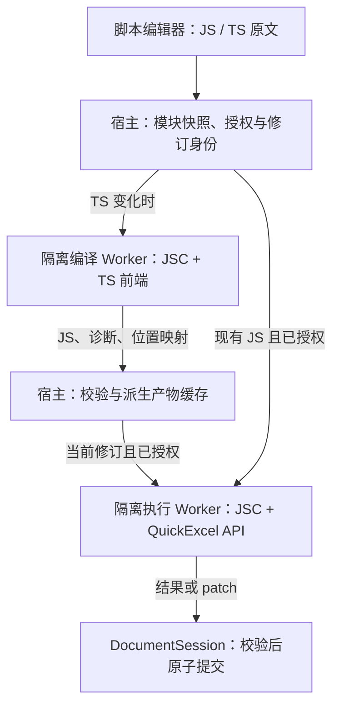

# JSC 单引擎替换与 TypeScript 接入方案

2026-11-03。状态：**J0–J6 已完成声明的工程范围；Windows/Linux 独立验证通过，JSC 已成为唯一生产引擎，Windows 默认包已激活为 0.6.0-preview.8**。用户已明确将 64 MiB 引擎硬限额延期，作为开放 issue `JSC-MEM-001` 保留，不再阻止后续阶段工作；不把该项标为已满足。构建、前端预算、原始证据和剩余工作见 [71 号实施记录](71-jsc-typescript-implementation-log.md)。

## 1 目标与决策边界

用户在 QuickExcel 脚本编辑器中直接编写 TypeScript，点击应用或运行即可使用，无需安装 Node.js、Bun、TypeScript 工具链，也无需手动编译或管理生成的 JavaScript。

目标执行架构采用 **JavaScriptCore（JSC）作为唯一工作簿脚本引擎，加内置 TypeScript 前端**。转换、诊断、缓存和错误位置映射由应用管理。JSC 本身实现 ECMAScript；Bun 的 TS 支持来自它的转译器，单独替换引擎不会自动获得 TS 语法支持。

| 项目 | 方案决定 |
| --- | --- |
| 最终执行引擎 | JSC；正式迁移完成后移除 QuickJS 生产依赖、桥接和构建入口 |
| Bun | 不引入 Bun 生产运行时，不维护裁剪 Bun 的长期分支 |
| TS 使用体验 | 内置自动处理，保留用户 TS 原文，执行时使用受校验的 JS 产物 |
| 单引擎含义 | 编译与执行可以使用不同进程和上下文，但使用同一套固定版本的 JSC；不保留引擎自动回退 |
| 现有 JavaScript | API v1 单源码包装和 API v2 模块继续兼容；已有 JS 不强制迁移为 TS |
| 主程序 | Core、DocumentSession、计算调度、动作事务和 Avalonia 宿主边界保持 |
| 实施顺序 | Windows 原型与契约对齐 → TS 接入 → Linux 独立验证 → 正式切换和旧引擎清理 |

本文不引入 npm 包安装、Node/Bun API、网络模块、TSX/JSX、脚本插件或异步 UDF。macOS 脚本执行仍关闭，不能因 JSC 在 Apple 平台可用而跳过 worker 隔离实现。开发期间可对照旧引擎结果，最终产品不提供双引擎选择器。

本方案的前端、格式字段和新增协议已实现，固定版本与最终资源配置见 71 号实施记录；编译进程预算依据 J5 实测冻结为 1 GiB。既有 M4 严格策略、部署以及 M6 门禁保持独立，不能由引擎替换自动关闭。

## 2 必须保留的现有契约

契约以当前实现及专题最新说明为准；历史文档中的 IPC 版本和早期隔离状态不覆盖当前 IPC 6。

| 范围 | 必须保留的行为 | 依据 |
| --- | --- | --- |
| 加载与兼容 | API v1 包装语义；v2 精确逻辑 ID、入口顺序、活绑定、循环依赖、共享模块每轮只初始化一次 | [包内模块](12-m4-modules.md) |
| 同步执行 | 初始化必须同步完成；拒绝不受支持的动态导入、待执行异步初始化和 Promise UDF 结果 | [包内模块](12-m4-modules.md)、[原生桥来源与限制](../../QuickExcel.Scripting/native/SOURCES.md) |
| 计算 | Blank/Text/Number/Boolean 与 v1/v2 区域形状；有序合批、懒分支、状态性调用顺序；失败不提交部分缓存 | [合批契约](14-m4-batching.md) |
| 动作与事件 | 不可变工作簿快照、验证后的 patch、修订身份检查、一次撤销；事件顺序和回滚规则 | [actions](13-m4-actions.md)、[事件与虚拟文件](69-script-events-and-virtual-files.md) |
| 虚拟文件 | `//xlsq/`、`//temp/`、`//mem/` 只表示逻辑字节快照；文件与单元格变更原子提交 | [事件与虚拟文件](69-script-events-and-virtual-files.md) |
| 授权 | 显式授权及既有证书信任规则；源码、绑定变更撤销授权，取消旧工作，拒绝迟到结果 | [数字签名与信任](20-script-signatures.md) |
| 故障与隔离 | 独立 worker、身份校验、取消和强杀、租约回收、无进程内或同权限回退 | [隔离](15-m4-os-isolation-adr.md)、[恢复](16-m4-recovery-and-deployment.md)、[平台](67-avalonia-platforms.md) |

纯粹更换引擎不增加脚本可访问的宿主能力。宿主仅注入既有 `quickExcel`、受限日志及快照/patch 接口，不导出 CLR 对象、原始句柄或 OS 路径。

## 3 目标架构

编译与执行均由宿主直接启动。编译 Worker 不启动执行 Worker；两者分别具有自己的 Job/租约或 Linux scope，避免违反现有单进程 Job 限制。共享的是引擎版本和原生实现，不共享 JS 对象、模块状态或执行上下文。

执行 Worker 仍按授权轮创建并销毁；不同动作和事件使用新实例。编译结果可以缓存，运行中的 JS 堆和上一次 UDF 结果不因迁移而跨轮复用。

Monaco/WebView 继续承担界面和编辑诊断，不成为工作簿脚本的执行后端。单引擎约束指产品管理的工作簿脚本运行时，不要求替换已有 WebView。

### 3.1 工程职责

| 工程或入口 | 拟调整职责 |
| --- | --- |
| `QuickExcel.Core` | 增加与引擎无关的模块语言及编译身份数据；保持纯 .NET，不引用 JSC 类型 |
| `QuickExcel.Scripting` | 用 JSC session 和自有 C ABI 替换 `QuickJsSession`；共用现有注册、动作、事件与虚拟文件 JS 契约 |
| `QuickExcel.ScriptWorker` | 受控编译/执行角色；角色在握手时锁定，隔离核验完成前不接收源码 |
| `QuickExcel.ScriptContracts` | BCL-only 的编译消息、诊断、产物身份与新版握手；继续严格验证帧、字段与请求身份 |
| `QuickExcel.Infrastructure/Scripting` | 编译调度、取消、缓存、引擎身份核验；沿用执行 runtime/action 适配与 OS 启动机制 |
| `QuickExcel.Infrastructure/Storage` | TS 原文、语言标记、必需特性、摘要及旧读取器拒绝策略 |
| `QuickExcel.Web/src/script.ts` 与桌面脚本页 | TS 模型、QuickExcel 类型声明、草稿同步、诊断和原始位置导航 |
| `scripts/ScriptWorker.targets` 与发布脚本 | 完整 worker payload、原生依赖和许可证；阻止旧引擎和探针进入正式包 |

具体内部类型名称在实施时确定。Core 不需要为了迁移引入长期多引擎注册框架。

## 4 JSC 嵌入设计

### 4.1 来源、构建与接口

优先验证上游 WebKit 的 JSCOnly 构建。固定源码 commit、归档哈希、编译器、构建选项和依赖版本；不得使用浮动 `main` 构建发布包。第三方预编译 DLL 仅可作为开发对照，不能替代可追溯的产品构建链。

使用仓库自有 C/C++ 桥向 .NET 暴露 C ABI，封装创建、加载、调用、诊断、取消状态及销毁。基础值和上下文操作尽量使用公开 C API；需要内部接口的部分集中在原生桥内，禁止把 JSC C++ 类型传到托管层。

JSCOnly 不等于无依赖：需核验所选构建的 WTF、分配器、ICU、系统运行库和许可证。JSC/WebKit 包含不同许可来源，不能按 QuickJS 的单一 MIT 许可沿用声明；在候选发布前落实相应通知、源码及重新链接要求。更换引擎后更新来源记录，保留历史 QuickJS 来源与许可证证据。

### 4.2 内存模块加载

公开 `JSEvaluateScript` 足以验证基本脚本，不足以完成现有 ES 模块迁移。原型必须验证 JSC 模块加载/链接接口、自有逻辑 ID resolver 和完全来自内存的源码 provider；如需内部 C++ API，应记录所依赖的符号与版本适配点。

模块加载必须继续拒绝相对/绝对路径、URL、未声明 ID、外部包和 import attributes。不得将模块写到临时目录后交给通用文件加载器，也不得以文本拼接或正则替换导入来规避模块语义。

JSC 模块 API 返回 Promise 或需要内部任务推进时，必须区分引擎链接所需工作与用户排入的异步任务。原型需证明可保留同步初始化、一次执行及拒绝待执行用户任务的契约；不能直接排空全部微任务队列作为适配方法。

### 4.3 资源和错误边界

现有执行预算保持为迁移验收约束：源码总量 1 MiB、最多 64 模块/入口、16 MiB IPC/native 消息、引擎分配 64 MiB、JS 栈 256 KiB、单次加载/调用 1 秒、整个执行轮 5 秒、进程 256 MiB。具体定义及合批限制继续以现有契约为准。

JSC 的堆、JIT 代码、后台线程和原生栈不一定能与 QuickJS 的计量方式一一对应。J0/J1 必须记录每个预算的计量对象、实现方法和失败行为；不能用 256 MiB 进程上限宣称已经满足 64 MiB 引擎上限。2026-11-03 用户调整：64 MiB 引擎硬限额记为开放 issue `JSC-MEM-001`，以后处理，不作为后续阶段推进的阻塞门禁。其余执行预算和隔离要求仍必须实现和验证；文档、策略身份及发布说明必须明确这项未实现的限制，不能静默宣称等效。

单次中断需要覆盖加载、函数执行和异常格式化；单线程 JS 中的计时器不能承担无限循环的兜底。宿主看门狗和 OS 终止仍必须独立生效。中断或引擎故障后销毁本轮，不复用受损 VM，不自动重放。

返回值、日志和诊断必须继续限额；错误文本不能作为可信的中断标志，也不能通过用户定义的 `stack` getter 获得额外执行机会。保持逻辑模块 ID 和源码位置，隐藏宿主实际路径。

## 5 TypeScript 前端与用户流程

### 5.1 首选验证路线

先验证 **官方 TypeScript 编译器的 JavaScript 版本运行在独立 JSC 编译上下文**。编译器是工作在 JSC 上的程序，不是第二套 JS 引擎。该路线可以共用 TS 的解析、转换、跨模块类型检查和 Source Map 能力。

候选必须是提供可嵌入 JavaScript Compiler API 的固定版本，并与编辑器的 TS 版本核对。官方 [Compiler API 说明](https://github.com/microsoft/TypeScript/wiki/Using-the-Compiler-API) 当前覆盖 TypeScript 6.0 及更早版本，并提示 7.1 的 API 将不同；不能直接假定后续版本仍可用相同方式载入 JSC。

J0 分开测量两种工作负载：仅语法转换，以及完整 Program 的跨模块检查与生成。推荐产品在应用 TS 脚本时完成完整检查和生成，并缓存成功产物；这一默认策略及时间目标在前端验证后冻结。不能把仅转译结果描述为完整类型检查通过。

若此路线达不到交互目标，可在同一编译端口下评估不带 JS VM 的原生 TS 前端；仍保持 JSC 为唯一工作簿执行引擎。前端选型必须记录语法、类型检查、模块转换和 Source Map 差异，不在发布时同时保留多个自动回退前端，也不为接入方便再嵌入 Bun/Node。

### 5.2 编译环境

编译输入来自不可变模块快照。自定义内存 host 仅解析声明的逻辑模块 ID，固定标准库和 `quickexcel.d.ts`；不得读取工作簿指定的 `tsconfig` 路径、环境变量、Node/DOM 类型、外部包、插件、自定义 transformer 或宏。

首版 TS 面向 API v2 模块；API v1 继续使用原有 JavaScript 包装。JS 与 TS 可在 v2 包内共存，类型导入消除后，运行时导入仍保持声明的逻辑 ID。编译必须保留 ESM 语义，不自动改成 CommonJS、注入 `require` 或引入额外运行库。

冻结编译选项和类型声明版本，包括目标 JS 语法、模块输出、严格检查、类字段、类型导入、枚举和 namespace 转换行为。TSX/JSX、装饰器元数据及需要未声明运行时辅助模块的语法不进入首版；不支持的输入必须明确诊断。不能只靠删除类型注解的正则表达式实现 TS 支持。

编译只处理源码，不运行工作簿顶层代码。打开、保存、迁移及编辑诊断不能因编译而执行用户脚本；模块初始化仍在既有授权规则下由执行 Worker 完成。

### 5.3 编辑、应用与运行

1. 编辑器保留原始 JS/TS，按语言启用高亮、补全和 QuickExcel 类型声明；编辑诊断与执行端使用一致的模块规则和选项。
2. 应用 TS 草稿时捕获源码、入口、绑定和修订身份，启动可取消编译；界面显示进度与错误，不要求用户执行编译命令。
3. 编译失败只返回诊断，不将部分输出作为当前可执行版本；已应用旧源码与当前失败草稿必须在 UI 中区分，不能把旧产物冒充新草稿执行。
4. 编译成功后宿主校验输出，并按现有源码变更规则提交新模块状态、失效旧授权及旧工作。
5. 用户运行或既有签名信任策略允许执行时，发送与当前源码匹配的 JS 产物；单元格变化触发的重算复用转换产物，但仍重建执行 VM。
6. 源码/选项/声明变化、停用、关闭或新编译使旧编译任务失效；取消和迟到结果遵循与计算相同的身份校验原则。

编译阶段单独确定源码、输出、Source Map、内存、时间、并发和队列预算。不能直接增大现有公式/actions 执行 Worker 的预算，也不能让重编译无期限占用用户操作。

J5 实测冻结的编译角色预算：1 GiB 进程、5 MiB JS 栈、5 秒原生操作/6 秒宿主截止、并发 1/队列 0。原文与生成 JS 各 1 MiB、最多 64 模块/入口、映射 4 MiB、诊断 128 条/16 KiB。真实隔离进程的密集输入暴露了 J0 探针 768 MiB 预算余量不足，因此据新证据调整并升级编译策略身份；执行预算保持 §4.3 约束。原始失败及新采样见 71 号记录。

### 5.4 缓存与错误定位

缓存键至少包含：语言标记、模块 ID/原始源码集合、入口顺序、脚本 API、编译选项、前端版本、标准库/QuickExcel 声明摘要及目标执行策略。绑定与授权身份必须在执行前再次核验。

首版优先使用宿主会话内派生缓存，不在 XLSQ 中持久化可执行 JS 缓存。缓存未命中时从已验证原文重新生成；不把跨引擎字节码作为文件交换格式，也不接受工作簿提供的任意原生产物。

生成 JS 和 Source Map 分别校验格式、条目、字节和路径范围；生成后仍需满足执行端预算，TS 原文未超限不代表产物一定可执行。Source Map 只引用逻辑模块，禁止加载远程映射或宿主文件；映射失败时返回有标识的生成位置，不能伪造 TS 行列。所有 UI 坐标统一转换为约定的行列基数。

## 6 文件、签名和 IPC 演进

| 边界 | 迁移策略 |
| --- | --- |
| 已有纯 JS XLSQ | 保持原有源码和 API v1/v2 语义；不因换引擎主动重写源码或旧签名载荷 |
| 含 TS 的 XLSQ | 原文为权威数据；模块语言标记与必需特性 `typescript-sources` 使旧读取器明确拒绝 |
| 文件 API 版本 | 语言与注册 API 分开表达；TS 不复用 v1 的包装约定，是否需要额外格式/签名版本在 J3 冻结 |
| 签名 | 新 TS 载荷覆盖语言、全部原文、模块身份、入口、绑定与影响语义的选项；旧 JS 签名载荷保持可验证 |
| 执行授权 | 运行身份同时绑定已验证源码、派生产物摘要、编译器/选项身份和 JSC 策略；缓存不能代替签名或授权 |
| IPC | 以当前 5 为基线，显式升级协议并同步宿主与 worker；不复用 `QuickJS-NG/0.17.0` 引擎标识 |
| 能力握手 | 明确编译/执行角色、API、消息预算、引擎构建和策略身份；版本或身份不匹配立即拒绝 |

引擎身份不是脚本语言版本，也不是源码签名。新引擎不能通过更改握手字符串绕过兼容验证；握手信息本身不构成二进制证明，发布清单及本地 payload 完整性核验仍需保留。

已有 JS 的证书信任是否可在新策略下直接复用，应在 J2/J3 明确并测试；策略不兼容时要求重新授权。不得删除现有签名、暗中改写摘要，或把无法验证的新载荷降级为已信任。

## 7 OS 隔离与平台推进

- **Windows x64**：保留零能力 AppContainer、挂起创建、令牌核验、显式 IPC 句柄、创建时 Job、环境白名单、只读私有 payload 和 journaled lease。分别验证编译和执行角色；失败关闭，不退回普通进程。
- **Linux x64**：保留 Landlock ABI >= 3、default-deny seccomp、经核验的 systemd 用户 scope、父进程死亡绑定和只读 payload。执行角色继续 256 MiB、无 swap、32 tasks、5 秒生命周期；编译角色如需不同资源配置，必须单独设计和验证，不能降低访问隔离。
- **JIT/GC**：验证启动、可执行内存、线程、信号、异常及 OOM 行为。现有 Linux 策略已经允许部分内存映射操作，不能预先断言 JIT 必然不可用，也不能遇到失败就整体放开 seccomp。
- **macOS**：只记录构建可行性不等于支持执行；本计划不提前启用现有尚未实现的 worker 隔离。

Windows 与 Linux 各自提供功能、负向访问、超限、取消、宿主崩溃和残留回收证据。普通用户环境验证不可被管理员运行结果或受限测试器中的跳过替代。

## 8 分阶段实施与退出条件

J0–J6 已完成独立实现、定向实测、默认切换和回退验证；具体覆盖与未完成项以 [实施记录](71-jsc-typescript-implementation-log.md) 为准。每阶段保留独立验收，不把开发探针放入正式依赖。

| 阶段 | 工作内容 | 退出条件 |
| --- | --- | --- |
| J0 来源与可行性 | 固定 JSC/TS 候选版本；Windows JSCOnly 构建；TS 前端两种路径；资源映射、许可和性能目标 | 可重复构建；给出真实限制、前端默认策略、编译预算及需解决的差异；无自动放宽现有预算 |
| J1 原生桥与模块 | 值桥、生命周期、内存模块、受限注册、同步语义、异常和中断 | 基础 JS/API v1/v2 模块及恶意输入定向检查通过；需要的内部 API 已集中封装 |
| J2 执行 Worker 对齐 | 新握手；批次、动作、事件、虚拟文件；Windows AppContainer 与恢复 | 当前 JS 工作簿契约通过；无部分提交、无重放、无回退；所有运行入口使用相同候选引擎 |
| J3 TS 编译与文件 | 隔离编译角色、校验/缓存、语言与特性标识、签名、Source Map、取消 | TS 原文保存/重开正确；旧版本拒绝新特性；错误和过期产物无法执行；跨模块检查策略符合 J0 决定 |
| J4 桌面接入 | Monaco TS 模型、草稿/应用/运行、诊断导航、状态与取消 | 用户无需外部工具即可编辑、应用、运行 TS；草稿、授权、修订与执行产物一致 |
| J5 Linux 与发布候选 | Linux 构建及隔离、Windows 部署矩阵、依赖完整性、性能专项 | 各平台独立证据齐全；受支持平台无隐式旧引擎后端；既有未关闭门禁如实保留 |
| J6 正式切换与清理 | 激活验收后的候选；移除旧引擎生产适配、复制和构建入口；同步文档 | 发布与依赖清单只含 JSC；QuickJS 原型/旧证据不进入产品；回退流程可用 |

以下是阶段推进规则：J0–J5 期间允许通过开发配置选择候选，不能把未经验证的候选设为默认。J6 已移除该双路径，默认构建只接受 JSC。若某受支持平台尚未通过 J5，不发布同时依赖两种引擎的“完成版”；继续保留此前正式版本，单独记录平台进度。

## 9 验证与性能证据

### 9.1 按变更区域运行定向检查

| 变更区域 | 复用/扩展的检查 |
| --- | --- |
| 语言桥与旧 JS | `M3ScriptTests`、`M4PolicyTests`、原生 smoke；数值/空值、区域形状、异常和非确定性策略保持 |
| 模块、调度与容量 | `M4ModuleTests`、`M4BatchTests`、`M4MessageBudgetTests`；循环/活绑定/TDZ、条件分支、调用顺序及边界字节 |
| 进程、协议与恢复 | `M4ProtocolTests`、`M4WorkerTests`、`M4WorkerFaultTests`、`M4RecoveryTests`、`M4IsolationTests` |
| 动作、事件与文件 | `M4ActionTests`、`ScriptEventFileTests`；单元格/文件原子提交、过期拒绝、撤销与事件顺序 |
| 格式与授权 | `ScriptSignatureTests` 及存储独立 fixture；旧 JS 签名、新 TS 特性、篡改、语言/选项变化和缓存错配 |
| 新 TS 行为 | 泛型/跨模块类型、仅类型导入、枚举/类字段、语法错误、未声明模块、输出超限、Source Map 与取消 |
| 桌面 | 脚本页和 Web 草稿协议定向检查；JS/TS 切换、失败草稿、原始行列、关闭与撤销授权 |

不要为每个切片运行全仓回归。托管 build/test/run/publish 一律设置仓库内 `--artifacts-path`；针对性测试与性能采样分开执行。正常发布所需检查在候选阶段按发布流程运行，失败证据保留，不以跳过隔离来使测试通过。

### 9.2 性能专项

分别记录冷启动、握手、源码传输、模块加载、TS 转换/完整检查、首轮与重复轮计算、动作/事件延迟、取消耗时、峰值内存、线程数和清理时间。覆盖小函数、多模块依赖、接近源码限额、简单大量 UDF、计算密集 UDF、动作与虚拟文件快照。

固定机器、源码输入、编译身份与预算，顺序采样并保存原始数据；重复次数不足时只报告中位数和范围，不宣称 p95。性能目标在 J0 根据真实交互基线冻结。不能把 JIT 热循环数据当作整轮提升，也不能把单纯转译与完整类型检查的时间直接相比。

开发产物和证据放在仓库内 `artifacts/jsc/`、`artifacts/typescript/` 等专用目录并保持 Git 忽略；探针、故障夹具和测试类型声明不得进入发布包。

## 10 切换、回退和完成定义

切换前保留最后一个已验证的 QuickJS **完整发布包**作为历史回退点。回退替换整个宿主和 worker，不在新版进程中偷偷切回旧引擎。旧包不理解 TS 特性时应明确拒绝；不能承诺回退后可执行新格式，也不能无提示丢弃 TS 原文。升级保存前应保留可恢复的原文件副本。

迁移完成要求：用户可直接编辑并运行受支持的 TS；已有 JS 契约通过；源码、编译、授权和结果身份完整闭合；受支持平台的隔离及恢复验证通过；所有生产公式、动作、事件和编译路径只使用固定 JSC 实现；旧 QuickJS 生产项目引用、原生目标、复制规则和发布断言已清理。

历史文档、来源、许可证和原始验证证据继续保留并标记适用版本。当前允许的兼容性偏差、编译策略及平台限制必须写入实施记录和用户说明；未通过这些条件时保持候选状态。

## 11 参考资料

以下为方案核对时使用的上游资料。实施阶段须记录所选固定 commit 对应的接口和构建说明，不能把文档存在当作 QuickExcel 已验证的证据。

- [WebKit JavaScriptCore 架构](https://docs.webkit.org/Deep%20Dive/JSC/JavaScriptCore.html)：引擎层次与 ECMAScript 实现范围。
- [JSCOnly 构建配置](https://github.com/WebKit/WebKit/blob/main/Source/cmake/OptionsJSCOnly.cmake)：独立引擎、Windows 分支及依赖。
- [JSC C API](https://github.com/WebKit/WebKit/blob/main/Source/JavaScriptCore/API/JSBase.h) 与 [模块加载入口](https://github.com/WebKit/WebKit/blob/main/Source/JavaScriptCore/runtime/Completion.h)：公开脚本 API 与内部模块接口的边界。
- [Bun 的源码加载机制](https://bun.com/docs/runtime/file-types)：TS loader 的转换职责；该能力不属于独立 JSC。
- [TypeScript Compiler API](https://github.com/microsoft/TypeScript/wiki/Using-the-Compiler-API)：程序、编译 host、诊断和生成接口。
- [WebKit 许可证说明](https://docs.webkit.org/Other/Licensing.html)：最终以所选源码及依赖的许可证文件为准。
